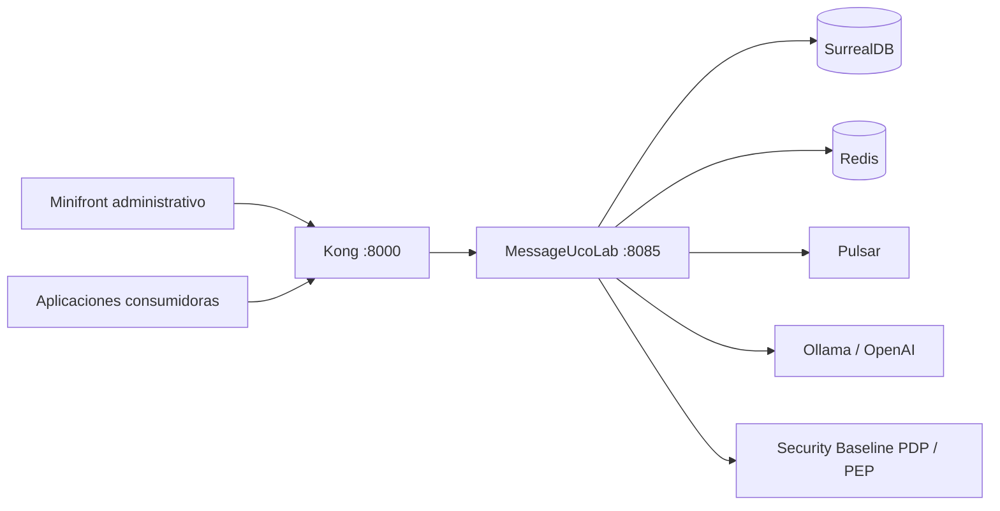

# MessageUcoLab

Building Block para administrar, traducir y distribuir mensajes de aplicaciones consumidoras. Centraliza el catálogo de textos por organización, aplicación y ambiente, y ofrece contratos HTTP y un cliente Java para que otros sistemas consulten los mensajes que deben mostrar.

> **Estado de seguridad:** la administración usa la sesión BFF y el PEP del componente externo Security Baseline. MessageUcoLab no emite tokens propios y no almacena contraseñas de usuarios.

## Contenido

- [Capacidades](#capacidades)
- [Arquitectura](#arquitectura)
- [Tecnologías](#tecnologías)
- [Requisitos](#requisitos)
- [Inicio rápido](#inicio-rápido)
- [API y seguridad](#api-y-seguridad)
- [Cliente Java](#cliente-java)
- [Calidad y pruebas](#calidad-y-pruebas)
- [Despliegue y CI/CD](#despliegue-y-cicd)
- [Documentación](#documentación)
- [Solución de problemas](#solución-de-problemas)

## Capacidades

- Espacios personales con **Organización → Aplicación → Ambiente → Funcionalidad → Mensaje**.
- Aprovisionamiento de los ambientes `Develop`, `Testing` y `Produccion` al crear una aplicación.
- Creación, consulta, edición y eliminación de mensajes con aislamiento por propietario y aplicación.
- Importación masiva desde Excel con validación previa, confirmación atómica e idempotencia.
- Traducción dinámica mediante LangChain4j y Ollama u OpenAI, con caché en Redis.
- Consulta pública temporal para aplicaciones consumidoras, limitada por aplicación y ambiente.
- Eventos SSE para actualizar el minifront administrativo.
- Contrato OpenAPI 3.0.3 y cliente reactivo para Java 25 / Spring Boot 4.1.1.
- Métricas Prometheus y envío de logs a Loki.

## Arquitectura

El backend sigue una arquitectura hexagonal organizada por funcionalidades:

```text
Controller / interceptor
        ↓
Interactor / caso de uso
        ↓
Puerto de dominio
        ↓
Adaptador de infraestructura
        ↓
SurrealDB · Redis · Pulsar · LangChain4j · Security Baseline
```

La dirección permitida entre módulos es `infrastructure → core → utils`.

| Módulo | Responsabilidad | Artefacto ejecutable |
|---|---|---|
| `utils` | Excepciones base, utilidades y códigos del catálogo | No |
| `core` | Dominio, casos de uso, puertos y validadores | No |
| `infrastructure` | API WebFlux, adaptadores, configuración y clase `CrossWordApplication` | Sí |
| `clients/java/messageucolab-client-api` | Contrato público del cliente Java | No |
| `clients/java/messageucolab-spring-boot-starter` | Autoconfiguración y adaptador HTTP del cliente | No |



Security Baseline es un componente externo: este repositorio solo consume sus contratos. La propiedad de organizaciones, aplicaciones y mensajes se valida además dentro de MessageUcoLab.

## Tecnologías

| Área | Tecnología |
|---|---|
| Lenguaje | Java 25 |
| Backend | Spring Boot 4.1.1, Spring Framework 7 y WebFlux |
| Persistencia principal | SurrealDB 3.1.4 en Docker; driver Java 2.1.1 |
| Caché y catálogo de textos | Redis |
| Eventos | Apache Pulsar 3.2.2 y SSE en memoria |
| Traducción | LangChain4j 1.15.1, Ollama u OpenAI |
| Gateway | Kong 3.5 |
| Seguridad | Sesión BFF y starter PEP 0.1.3 |
| Observabilidad | Actuator, Micrometer, Prometheus, Loki y Grafana |
| Contrato | OpenAPI 3.0.3 y SpringDoc 3.1.1 |
| Build | Maven Wrapper 3.9.9, JaCoCo 0.8.15 y Docker BuildKit |

## Requisitos

Para el arranque oficial del entorno local se necesita:

1. Docker Engine con Docker Compose.
2. Doppler CLI vinculado al proyecto `messageucolab`, configuración `dev`.
3. Acceso de lectura al paquete Maven privado del starter PEP mediante `GITHUB_PACKAGES_USER` y `GITHUB_PACKAGES_TOKEN`.
4. Los servicios externos de Security Baseline disponibles en el entorno local. Este proyecto **no** los inicia ni los modifica.

JDK 25 y el Maven Wrapper 3.9.9 solo son necesarios para compilar o ejecutar verificaciones directamente en el host; no forman parte del arranque oficial con Docker.

Los secretos se inyectan con Doppler. No se requiere un `.env` con credenciales y nunca deben copiarse secretos al repositorio.

Verifique primero las herramientas:

```powershell
docker version
docker compose version
doppler --version
```

## Inicio rápido

### 1. Clonar el repositorio

```bash
git clone https://github.com/CamiloGarcia09/NosGraduamos-FC.git
cd NosGraduamos-FC
```

### 2. Construir y levantar el stack Docker completo

Desde `deployment/docker`, Doppler inyecta la configuración y Docker Compose construye y levanta MessageUcoLab junto con SurrealDB, Redis, Pulsar, Kong, observabilidad y traducción:

```powershell
cd deployment/docker
doppler run --project messageucolab --config dev -- docker compose up -d --build
cd ../..
```

Este único comando es el arranque oficial: no ejecute después `spring-boot:run` ni Maven en el host. El Compose incluye el backend y los inicializadores para el esquema de SurrealDB, el catálogo Redis y el modelo local de Ollama. No ejecute el seed completo sobre una base con información que deba conservarse.

El flujo de sesión BFF está activo por defecto y no requiere perfiles de Spring. Desde el contenedor, el PDP y el PEP se alcanzan mediante `host.docker.internal` según la configuración de Doppler.

### Reconstruir únicamente el backend

Si el stack ya está disponible y solo cambió el backend, puede reconstruir y recrear únicamente MessageUcoLab:

```powershell
cd deployment/docker
doppler run --project messageucolab --config dev -- docker compose up -d --build --no-deps messageucolab
```

Esta variante no sustituye el arranque completo inicial. El `Dockerfile` ejecuta `clean verify`; por ello la construcción exige las credenciales de GitHub Packages.

Para usar la imagen ya publicada sin compilar el código, consulte [`deployment/local/README.md`](deployment/local/README.md).

### Servicios locales

| Servicio | URL |
|---|---|
| Backend directo | `http://localhost:8085` |
| API por Kong | `http://localhost:8000` |
| Swagger UI | `http://localhost:8085/swagger-ui.html` |
| OpenAPI YAML | `http://localhost:8085/openapi.yaml` |
| Health | `http://localhost:8085/actuator/health` |
| Métricas | `http://localhost:8085/actuator/prometheus` |
| Grafana | `http://localhost:3000` |
| Prometheus | `http://localhost:9090` |

Los puertos de infraestructura se parametrizan en Doppler y en la configuración local de despliegue; no deben suponerse iguales en todos los ambientes.

## API y seguridad

El contrato canónico es [`infrastructure/src/main/resources/static/openapi.yaml`](infrastructure/src/main/resources/static/openapi.yaml). Los controladores no sustituyen este archivo como fuente de documentación.

### Administración protegida

Las rutas administrativas usan la cookie `SECURITY_BASELINE_SESSION`, autorización por ruta en el PEP y comprobaciones de propiedad en el dominio. El navegador debe enviar la cookie con credenciales incluidas. Las operaciones de mensajes también usan `X-Application-Id`; cuando corresponde, el ambiente llega explícitamente en `X-Environment-Id` o en el cuerpo de la solicitud.

Rutas principales:

| Método | Ruta | Uso |
|---|---|---|
| `GET` | `/messageucolab/v1/session/user` | Usuario autenticado |
| `GET/POST` | `/messageucolab/v1/organizations` | Organizaciones personales |
| `GET` | `/messageucolab/v1/organizations/{id}/applications` | Aplicaciones propias |
| `POST` | `/messageucolab/v1/application` | Crear aplicación y ambientes |
| `POST` | `/messageucolab/v1/application/functionality` | Crear funcionalidad |
| `GET/POST` | `/messageucolab/v1/messages` | Consultar o crear mensajes |
| `PUT/DELETE` | `/messageucolab/v1/messages/{code}` | Editar o eliminar un mensaje |
| `POST` | `/messageucolab/v1/messages/{code}/translations` | Traducir un mensaje |
| `GET/POST` | `/messageucolab/v1/messages/imports/**` | Importación masiva |

No se debe usar el correo del navegador como identidad ni aceptar un propietario enviado por el cliente. La identidad estable se deriva de `identity_source + tenantId + subject` de la sesión BFF.

### Consulta pública para consumidores

Mientras el componente de seguridad no ofrezca autorización aplicación-a-aplicación, estas dos rutas son públicas y no pasan por el PEP:

```http
GET /messageucolab/v1/public/messages
GET /messageucolab/v1/public/messages/{code}?language=en
X-Application-Id: <uuid-aplicacion>
X-Environment-Id: <uuid-ambiente>
```

Ejemplo:

```bash
curl -H "X-Application-Id: <uuid-aplicacion>" \
     -H "X-Environment-Id: <uuid-ambiente>" \
     http://localhost:8000/messageucolab/v1/public/messages
```

Kong limita este acceso a 120 solicitudes por minuto y por IP. La API solo devuelve mensajes activos y habilitados para el ambiente indicado. Consulte [`docs/consumo-mensajes.md`](docs/consumo-mensajes.md) antes de integrar un consumidor.

## Cliente Java

Los consumidores con Java 25 y Spring Boot 4.1.1 pueden usar el starter publicado en GitHub Packages:

```xml
<repositories>
    <repository>
        <id>github</id>
        <url>https://maven.pkg.github.com/CamiloGarcia09/MessageUcolab--Backend</url>
    </repository>
</repositories>

<dependency>
    <groupId>co.edu.uco</groupId>
    <artifactId>messageucolab-spring-boot-starter</artifactId>
    <version>0.1.0</version>
</dependency>
```

Configure las credenciales de lectura de GitHub Packages en el `settings.xml` o gestor de secretos del consumidor, nunca en el POM.

```yaml
messageucolab:
  url: ${MESSAGEUCOLAB_URL:http://localhost:8000}
  application-id: ${MESSAGEUCOLAB_APPLICATION_ID}
  environment-id: ${MESSAGEUCOLAB_ENVIRONMENT_ID}
  timeout: 60s
```

El bean `MessageReader` permite consultar el catálogo o un mensaje específico:

```java
Mono<MessageDetails> message = messageReader.getDetails("MSG_PRODSAVED");
Mono<MessageDetails> translated = messageReader.getDetails("MSG_PRODSAVED", "en");
Mono<MessageCollection> catalog = messageReader.getAll();
```

La guía completa está en [`docs/consumo-mensajes.md`](docs/consumo-mensajes.md).

## Calidad y pruebas

El build completo usa el Maven Wrapper y genera reportes JaCoCo:

```powershell
.\mvnw.cmd clean verify
```

Los módulos del backend tienen gates mínimos de 80 % en líneas y ramas. Los reportes se generan en `<modulo>/target/site/jacoco/index.html`.

No hay un formatter o linter Java configurado. Todo cambio debe conservar la arquitectura hexagonal, la jerarquía de excepciones de dominio y el catálogo de textos de Redis. Una compilación exitosa no reemplaza las validaciones de integración con SurrealDB, Redis, el PEP/PDP y Kong.

## Despliegue y CI/CD

- `azure-pipelines.yml` ejecuta `clean verify`, publica resultados y cobertura, valida Docker Compose/Bicep y construye la imagen.
- `azure-deploy-pipeline.yml` despliega o detiene el entorno de demostración de Azure mediante una ejecución manual protegida.
- El `Dockerfile` usa una imagen de ejecución JRE 25, usuario sin privilegios, capas de Spring Boot y secretos BuildKit para Maven.
- Los secretos de despliegue se administran en Doppler y Azure Key Vault; no se versionan.

El flujo automatizado del repositorio está configurado para `develop`: CI se activa en esa rama y en pull requests dirigidos a ella; el despliegue también rechaza orígenes distintos de `develop`. No publique directamente en `main` sin seguir la política de ramas y revisar previamente la divergencia entre ambas ramas.

## Documentación

| Documento | Contenido |
|---|---|
| [`docs/arquitectura.md`](docs/arquitectura.md) | Arquitectura, módulos y decisiones técnicas |
| [`docs/contrato-api.md`](docs/contrato-api.md) | Resumen oficial del contrato HTTP |
| [`docs/integracion-seguridad.md`](docs/integracion-seguridad.md) | Sesión BFF, PEP y límites con seguridad |
| [`docs/espacios-personales.md`](docs/espacios-personales.md) | Propiedad de organizaciones y aplicaciones |
| [`docs/consumo-mensajes.md`](docs/consumo-mensajes.md) | API de consumo y cliente Java |
| [`docs/importacion-mensajes.md`](docs/importacion-mensajes.md) | Importación masiva desde Excel |
| [`docs/despliegue.md`](docs/despliegue.md) | Desarrollo local, Docker, CI/CD y Azure |
| [`infrastructure/src/main/resources/static/openapi.yaml`](infrastructure/src/main/resources/static/openapi.yaml) | Contrato OpenAPI canónico |

## Solución de problemas

### Maven no puede descargar el starter PEP

Compruebe que `GITHUB_PACKAGES_USER` identifica la cuenta de GitHub y que `GITHUB_PACKAGES_TOKEN` tiene `read:packages`. No copie el token en `.mvn/settings.xml`; la plantilla versionada usa variables de entorno.

### La API responde 401

La sesión BFF está ausente, vencida o no puede validarse. Compruebe la disponibilidad del PDP y el envío de cookies. MessageUcoLab no genera una sesión alternativa.

### La API responde 403

El PEP denegó el permiso de la ruta o el recurso no pertenece al usuario autenticado. No desactive el enforcement ni cambie el componente de seguridad desde este repositorio.

### La aplicación no conecta con seguridad desde Docker

Dentro del contenedor, `localhost` apunta al propio contenedor. En el entorno local use las URLs configuradas para `host.docker.internal:18080` y `host.docker.internal:18081`.

### El esquema o los catálogos no coinciden

Los inicializadores completos están pensados para instalaciones nuevas. No borre volúmenes ni reimporte el seed sobre datos que deban conservarse; revise primero la migración específica y las guías de `docs/`.

### Versiones de Java incompatibles

Confirme que `java -version`, `JAVA_HOME` y `.\mvnw.cmd -version` usan JDK 25. El proyecto no utiliza características preview.
