# Guía de actualización

Esta guía es para los equipos que **ya tienen MessageUcoLab 0.2.0 instalado** con el kit
`messageucolab-local`. Tus aplicaciones, tus mensajes y tu configuración de Doppler se conservan.

## Qué cambió y por qué

Estos cambios nacieron de las sugerencias de los equipos que usan el componente.

| Sugerencia | Quién la sugirió | Cómo se resolvió |
|---|---|---|
| Ampliar el rango de caracteres de los mensajes | Componente de seguridad, Fábrica de software y Equipo de asistencia | El código admite hasta **500** caracteres, el título de **5 a 1000** y el contenido de **5 a 2000**. |
| Aplicar el Top 10 de OWASP | Componente de seguridad | Se cerró el acceso sin autenticación a los mensajes, se restringió CORS a orígenes declarados, se corrigieron errores 500 por rutas y métodos no admitidos, y la traducción con IA quedó protegida contra instrucciones ocultas en los textos. |
| Inactivar o eliminar funcionalidades y aplicaciones | Fábrica de software | Una funcionalidad se puede **inactivar** y sus mensajes se inactivan con ella. Una aplicación se puede **eliminar** junto con todos sus datos. |
| Separar las imágenes por el peso de la traducción | Componente de parámetros y Equipo de asistencia | La traducción con IA pasa a ser **opcional**. Tú eliges: el kit **sin** Ollama ni modelo (liviano, es lo que viene por defecto) o el kit **con** Ollama y su modelo, que se levantan dentro de Docker. No se instala nada en tu PC. |

Además, esta versión trae un cambio **obligatorio**: la integración con el componente de seguridad. Las
aplicaciones que consumen mensajes dejan de usar rutas públicas con identificadores y pasan a usar su
**identidad de servicio**. No es una sugerencia: sin ese paso, tu aplicación no puede leer mensajes.

| Si tú… | Haz |
|---|---|
| Administras tu MessageUcoLab local | La **Parte A** (pasos 1 a 6) |
| Tienes una aplicación que consume mensajes | La **Parte A** y después la **Parte B** (pasos 7 a 14) |

Necesitas Docker Desktop abierto, tu componente de seguridad funcionando y el archivo
**`messageucolab-local.zip`** nuevo que acompaña esta guía. También necesitas el libro
**`recursos-messageucolab-0.3.0.xlsx`** (paso 5), que trae todas las rutas de MessageUcoLab.

> **Cuidado:** No ejecutes `docker compose down -v`: borra todos tus mensajes.

## Parte A. Actualizar MessageUcoLab

Todo lo que cambió viene en la **imagen nueva** y en el **kit**: tú solo reemplazas la carpeta y ejecutas **un
comando**. Al arrancar, el kit carga solo los textos nuevos del catálogo y crea las tablas nuevas. Tus
aplicaciones, tus mensajes y tu configuración de Doppler se conservan.

> **Cuidado:** No ejecutes `docker compose down -v`: borra todos tus mensajes.

### Paso 1. Reemplazar la carpeta del kit

1. Descomprime `messageucolab-local.zip` en una carpeta temporal.
2. Copia **todo** su contenido sobre tu carpeta `messageucolab-local` y acepta reemplazar los archivos, **también
   el `.env`**: no lleva contraseñas (esas siguen en Doppler) y ya trae la versión `0.3.0`. Si habías cambiado
   algún puerto, vuelve a ponerlo.

### Paso 2. Actualizar con un solo comando

Abre una terminal **dentro de `messageucolab-local`**. Elige **una** de las dos formas: la diferencia es el
**perfil `ollama`**, que es el que descarga Ollama y su modelo de traducción.

**Sin traducción** (lo normal; **no** descarga Ollama ni el modelo, que pesan varios GB). **No** pongas el perfil:

```bash cwd=C:\…\messageucolab-local
doppler run -- docker compose -p messageucolab up -d --force-recreate
```

**Con traducción.** Pon `--profile ollama` **antes** de `up`: así se descargan y se levantan Ollama y su modelo,
todo dentro de Docker, sin instalar nada en tu PC. La primera vez tarda varios minutos:

```bash cwd=C:\…\messageucolab-local
doppler run -- docker compose -p messageucolab --profile ollama up -d --force-recreate
```

> **Cuidado:** mantén comentada la línea `# COMPOSE_PROFILES=ollama` del `.env`. Con la línea activa, el perfil
> se aplicaría también cuando no lo escribes en el comando.

Cualquiera de los dos comandos descarga la imagen `0.3.0`, vuelve a cargar los textos del catálogo, crea las
tablas nuevas, reinicia Kong con sus rutas nuevas y deja listo Pulsar para los avisos.

**Encenderla o apagarla desde el Catálogo de Parámetros (opcional).** Si tu equipo usa el componente de
Parámetros, puede decidir allí si se traduce, **sin reiniciar MessageUcoLab**. El valor de
`TRANSLATION_AI_ENABLED` queda solo como respaldo para cuando el Catálogo no tiene el parámetro o no responde.

1. En el frontend del Catálogo, en la aplicación de MessageUcoLab, crea el parámetro
   **`TRADUCCION_HABILITADA`** con el valor `true` (traducir) o `false` (no traducir).
2. En **Tokens → Nuevo**, crea un token para esa aplicación y ese ambiente. Copia su **ID** y su **secreto**: el
   secreto se muestra una sola vez.
3. Pon los valores en tu kit. El secreto va en **Doppler**, nunca en el `.env`:

| Variable | Dónde | Valor |
|---|---|---|
| `CATALOGO_PARAMETROS_BASE_URL` | `.env` de `messageucolab-local` | `http://host.docker.internal:8081/catalogo-parametros/api/v1` |
| `CATALOGO_PARAMETROS_TOKEN_ID` | `.env` de `messageucolab-local` | El ID del token |
| `CATALOGO_PARAMETROS_SECRETO` | Doppler | El secreto del token |

MessageUcoLab revisa el parámetro cada minuto: al cambiarlo en el Catálogo, en menos de un minuto empieza o deja
de traducir. Para que traduzca de verdad, tienes que haber levantado MessageUcoLab con `--profile ollama`.


### Paso 3. Comprobar que quedó actualizado

En Docker Desktop → **Containers**:

| Contenedor | Debe decir |
|---|---|
| `messageucolab-app` | Imagen `jciro17/messageucolab:0.3.0` y **healthy** |
| `redis-message-catalog-init` y `surrealdb-message-structure-init` | **Exited (0)**: terminaron bien |
| `pulsar` | **Running** |

Y <http://localhost:8000/actuator/health> debe mostrar `{"status":"UP"}`.

### Paso 4. Liberar espacio (opcional)

El kit anterior siempre instalaba Ollama y su modelo. Si usas MessageUcoLab **sin traducción**, puedes borrar lo que ya
no se usa:

```bash cwd=C:\…\messageucolab-local
docker rm -f ollama ollama-model-init
```

```bash cwd=C:\…\messageucolab-local
docker volume rm messageucolab_ollama-data
```

Pulsar conserva sus datos en el volumen de siempre (`messageucolab_pulsar-data`): **no lo borres**. El volumen
`messageucolab_pulsar-conf` ya no se usa y se puede retirar si ningún contenedor lo tiene montado. Si algo dice que no
existe, no pasa nada: ya estaba limpio.

### Paso 5. Registrar las rutas nuevas en seguridad

El libro **`recursos-messageucolab-0.3.0.xlsx`** trae las 33 rutas de MessageUcoLab. De ellas, seis son nuevas
en esta versión (las de la tabla). Hay que registrarlas en el componente de seguridad y asignarlas al rol que
usan tus usuarios para administrar MessageUcoLab.

| Método | Ruta | Para qué sirve |
|---|---|---|
| `DELETE` | `/messageucolab/v1/application/{applicationId}` | Eliminar una aplicación |
| `PATCH` | `/messageucolab/v1/application/functionality/{functionalityId}/state` | Inactivar o activar una funcionalidad |
| `GET` | `/messageucolab/v1/messages/events` | Refrescar la lista de mensajes en la pantalla |
| `GET` | `/messageucolab/v1/application/{applicationId}/service-identities` | Ver las identidades de una aplicación |
| `POST` | `/messageucolab/v1/application/{applicationId}/service-identities` | Registrar una identidad |
| `DELETE` | `/messageucolab/v1/application/{applicationId}/service-identities/{clientId}` | Quitar una identidad |

1. En la consola de seguridad (<http://localhost:5173>), entra a **Carga masiva**. En **¿Qué quieres cargar?** elige
   **Cargar recursos**, arrastra **`recursos-messageucolab-0.3.0.xlsx`**, pulsa **Validar archivo** y luego
   **Confirmar carga**. Si avisa que algunas rutas ya existen, es normal: son las de versiones anteriores.

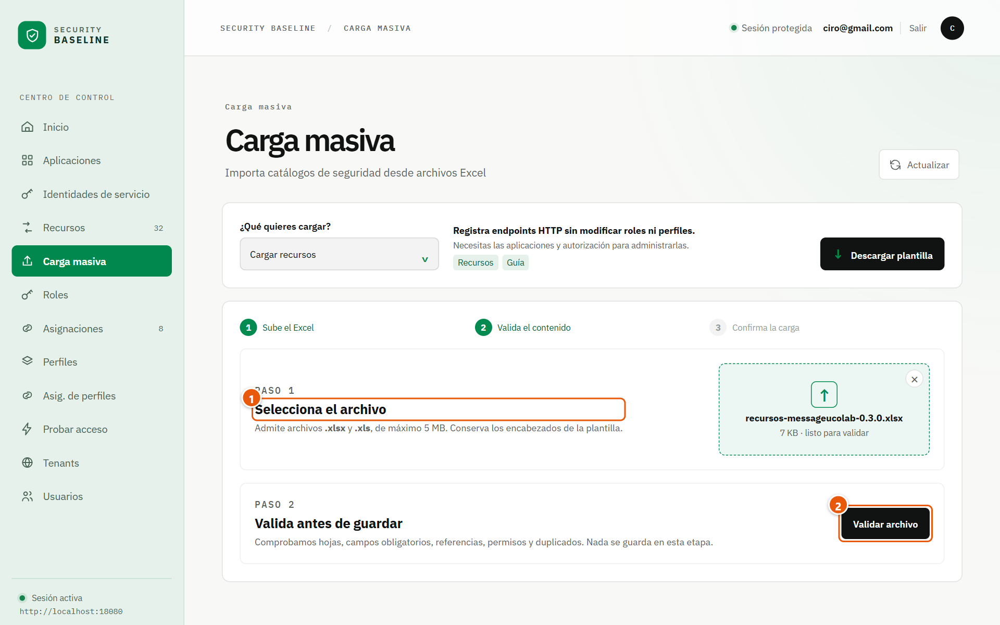

::: leyenda
1. **Archivo** — `recursos-messageucolab-0.3.0.xlsx`, listo para validar.
2. **Validar archivo** — revisa las filas antes de crearlas; todavía no guarda nada.
:::

2. En **Roles**, pulsa **Gestionar permisos** en el rol de tus administradores, elige **MessageUcoLab** y ese rol, y
   pulsa **Asignar visibles** y **Guardar cambios**.

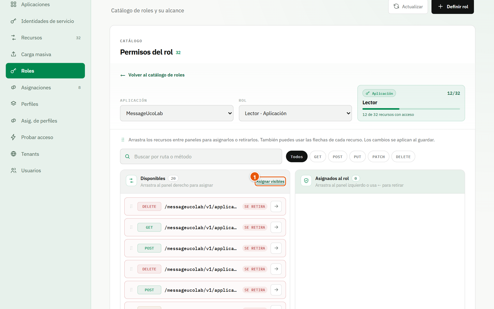

::: leyenda
1. **Asignar visibles** — pasa al rol todas las rutas de la lista.
2. **Guardar cambios** — aplica la asignación; sin este clic no se guarda nada.
:::

### Paso 6. Actualizar la pantalla

Para que la pantalla de MessageUcoLab muestre la eliminación de aplicaciones, el estado de las
funcionalidades y el botón **Identidades de servicio**, trae la última versión de su carpeta y reinicia
`npm run dev`:

```bash cwd=C:\…\MessageUcolab--Frontend
git pull origin develop
```

El botón **Copiar identificadores** **desaparece**: ya no hay identificadores que copiar. Si usas el minifront
en tu aplicación, trae también su última versión:

```bash cwd=C:\…\tu-pantalla
npm install github:Jciro17/minifront-mensajes
```

El minifront ya no consume mensajes sin sesión. Para mostrar mensajes a personas sin iniciar sesión, la
aplicación los pide a su propio backend (Parte B, paso 12).

## Parte B. Si tu aplicación consume mensajes

Antes, tu backend pedía los mensajes a una ruta pública con el identificador de la aplicación y el del ambiente.
Ahora entra con una **identidad de servicio**: un "usuario para máquinas" con un **Client ID** (su nombre) y un
**secreto** (su clave), que se crea en el componente de seguridad. **Ya no envías identificadores.** Se configura
en cuatro pasos cortos (7 a 10) y luego se conecta tu backend (paso 11).

| Paso | Qué resuelve | Dónde |
|---|---|---|
| 7. Crear la identidad | Quién es tu backend | Seguridad, <http://localhost:5173> |
| 8. Pedir el permiso | Qué puede hacer: leer mensajes | Seguridad, <http://localhost:5173> |
| 9. Aprobar el permiso | Que se autorice (lo apruebas tú) | Seguridad, <http://localhost:5173> |
| 10. Elegir el ambiente | Qué mensajes lee: Develop, Testing o Produccion | MessageUcoLab, <http://localhost:5174> |

Los ejemplos usan la aplicación `Inventario UCO`, la identidad `inventario-dev` y el ambiente `Develop`.

> **Una identidad = un ambiente.** Para leer los mensajes de Testing, repite los pasos 7 a 10 con otra identidad,
> por ejemplo `inventario-test`.

### Paso 7. Crear la identidad

En <http://localhost:5173>, entra a **Identidades de servicio** en el menú de la izquierda.

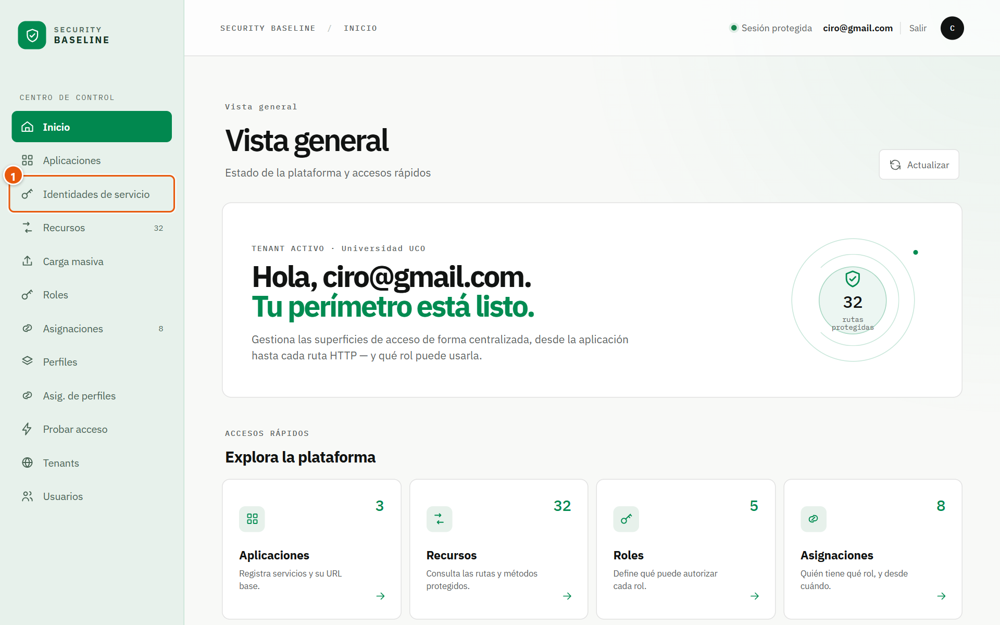

::: leyenda
1. **Identidades de servicio** — donde se crean las identidades y se piden sus permisos.
:::

En la pestaña **Identidades**, elige tu aplicación y pulsa **Crear identidad**.

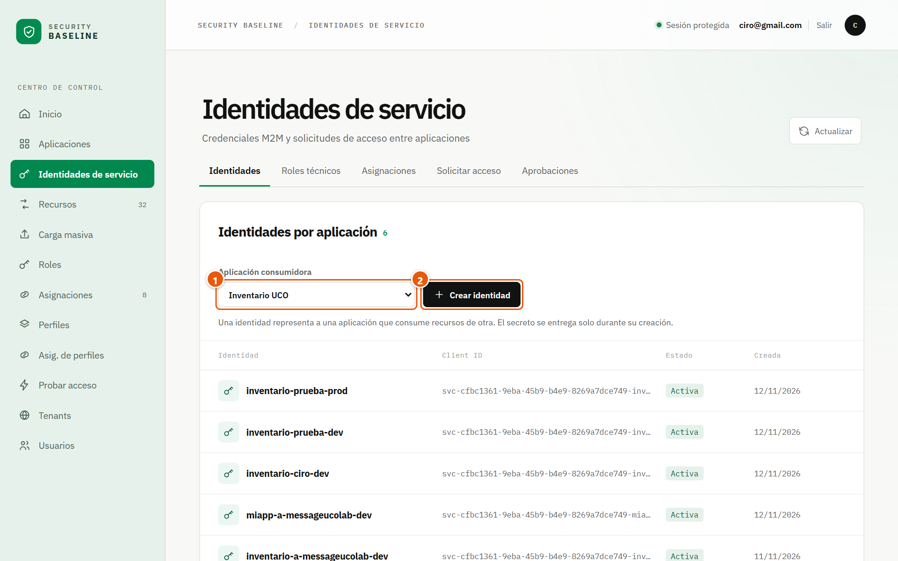

::: leyenda
1. **Aplicación consumidora** — la aplicación que va a leer mensajes.
2. **Crear identidad** — abre la ventana para ponerle nombre.
:::

Escribe el nombre (solo minúsculas, números y guiones) y confírmalo.

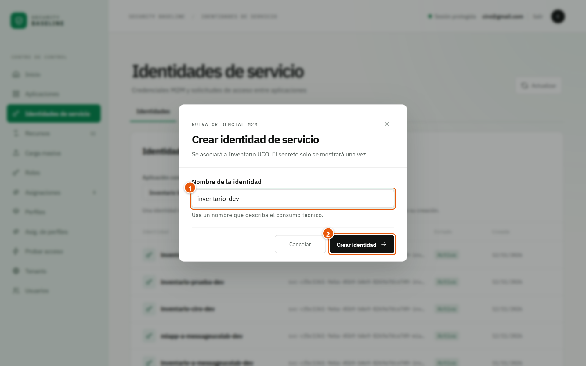

::: leyenda
1. **Nombre de la identidad** — `inventario-dev`.
2. **Crear identidad** — la crea y genera su secreto.
:::

Aparece el **secreto**. Cópialo y guárdalo ya en un bloc de notas.

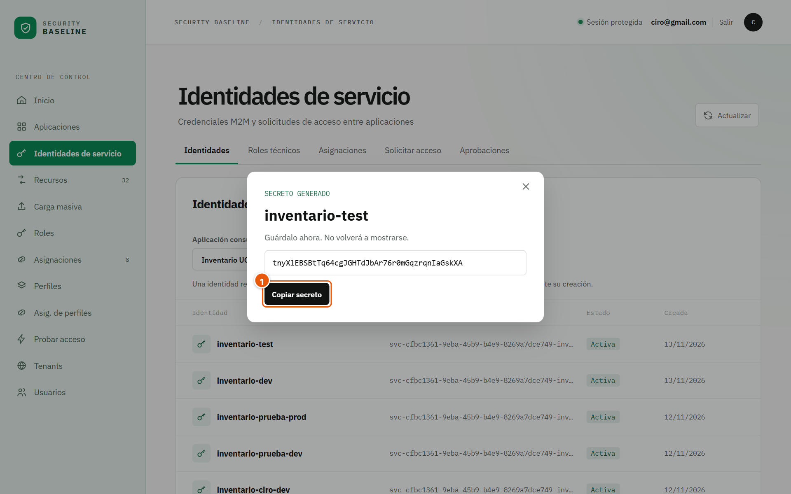

::: leyenda
1. **Copiar secreto** — copia la clave. En tu pantalla verás el nombre de tu identidad en lugar del de la imagen.
:::

> **Cuidado:** esta ventana **no se vuelve a abrir**. Si la cierras sin copiar el secreto, tendrás que crear
> otra identidad.

Cierra la ventana. En la lista, copia el **Client ID** de tu identidad (triple clic sobre él y **Ctrl+C**) y
guárdalo junto al secreto.

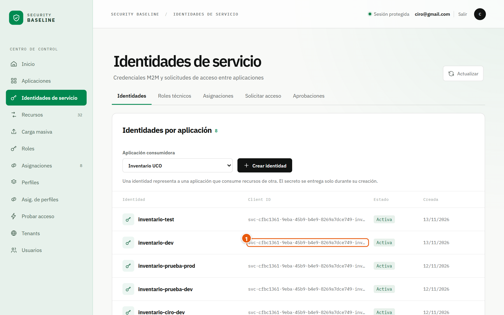

::: leyenda
1. **Client ID** — empieza por `svc-`; en pantalla se ve cortado, pero se copia completo.
:::

### Paso 8. Pedir el permiso de lectura

En la pestaña **Solicitar acceso**, llena las cinco listas de arriba hacia abajo como en la imagen y pulsa
**Enviar solicitud**. El formulario se vacía cuando se envía.

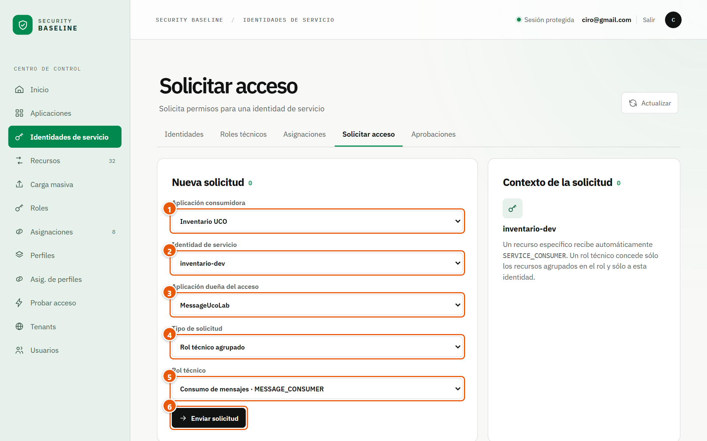

::: leyenda
1. **Aplicación consumidora** — tu aplicación.
2. **Identidad de servicio** — la que creaste en el paso 7.
3. **Aplicación dueña del acceso** — siempre `MessageUcoLab`.
4. **Tipo de solicitud** — `Rol técnico agrupado`.
5. **Rol técnico** — `Consumo de mensajes · MESSAGE_CONSUMER`.
6. **Enviar solicitud** — la deja pendiente de aprobación.
:::

### Paso 9. Aprobar el permiso

En la pestaña **Aprobaciones**, elige **MessageUcoLab** y pulsa **Aprobar** en la solicitud. Si no la ves,
pulsa **Actualizar**: la lista no se refresca sola.

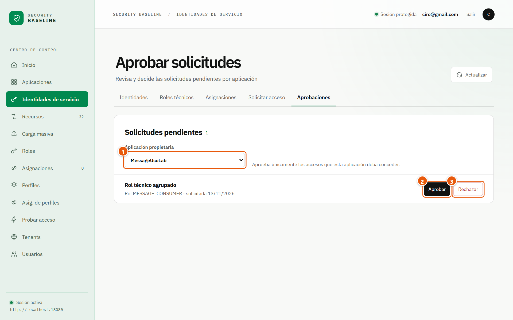

::: leyenda
1. **Aplicación propietaria** — `MessageUcoLab`.
2. **Aprobar** — concede el permiso de lectura.
3. **Rechazar** — no lo concede; no lo pulses.
:::

En **Asignaciones**, con tu aplicación y tu identidad, la fila `MESSAGE_CONSUMER` debe decir **Aprobada**.

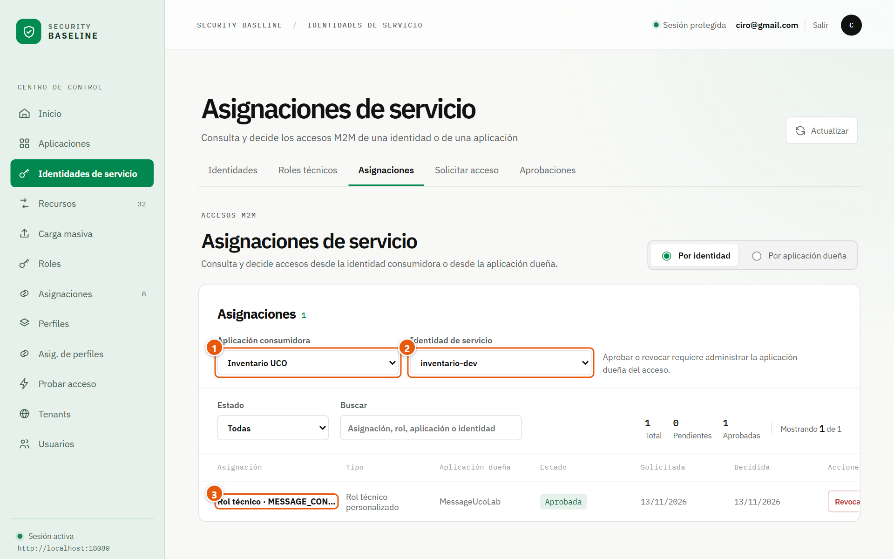

::: leyenda
1. **Aplicación consumidora** — tu aplicación.
2. **Identidad de servicio** — tu identidad.
3. **Fila del permiso** — `MESSAGE_CONSUMER`, **Aprobada**.
:::

### Paso 10. Elegir el ambiente que lee la identidad

En <http://localhost:5174>, entra a tu organización y pulsa **Identidades de servicio** debajo de la tarjeta
de tu aplicación.

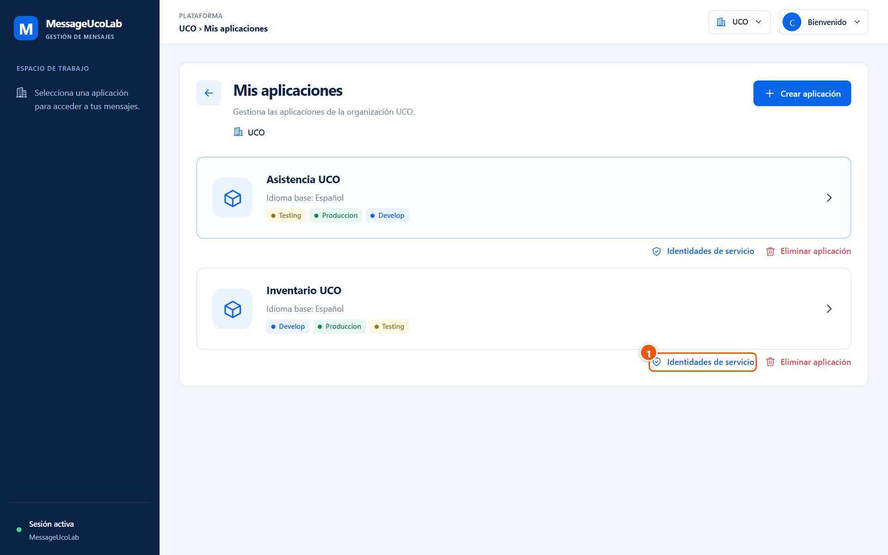

::: leyenda
1. **Identidades de servicio** — asocia una identidad a un ambiente de esta aplicación.
:::

Elige el ambiente, pega el **Client ID** (no el secreto) y pulsa **Registrar**.

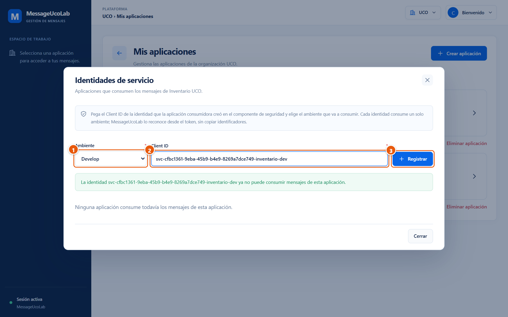

::: leyenda
1. **Ambiente** — el que va a leer tu backend, por ejemplo `Develop`.
2. **Client ID** — el que empieza por `svc-`.
3. **Registrar** — asocia la identidad al ambiente.
:::

Tu identidad aparece en la lista con su ambiente al lado. Listo: tu backend ya está autorizado.

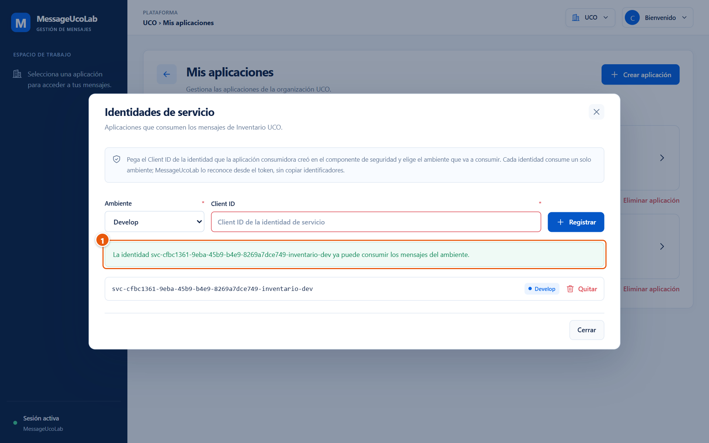

::: leyenda
1. **Identidad registrada** — el Client ID con su ambiente.
:::

### Paso 11. Conectar tu backend

En tu `pom.xml`, cambia la versión del cliente de MessageUcoLab y agrega la dependencia de seguridad, que es la
que pide el token de tu identidad. Tu backend necesita Spring Boot 4.1.1 y Java 25 (en su `pom.xml` y en la
imagen base de su `Dockerfile`).

```xml file=pom.xml
<dependency>
  <groupId>co.edu.uco</groupId>
  <artifactId>messageucolab-spring-boot-starter</artifactId>
  <version>0.1.3</version>
</dependency>
<dependency>
  <groupId>co.edu.uco</groupId>
  <artifactId>security-pep-integration-spring-boot-starter</artifactId>
  <version>0.1.4</version>
</dependency>
```

Los dos repositorios de GitHub Packages necesitan `<id>` distintos (`github-messageucolab` y `github-seguridad`),
cada uno con su `<server>` en el `settings.xml` con el que se construye tu imagen; el detalle está en el paso 8.1
de la guía de integración.


Son tres archivos: `application.yml` y `docker-compose.yml`, que se suben a Git, y `.env`, que guarda el Client ID
y el secreto y **no** se sube.

**1. `application.yml`.** Se agregan los bloques `messageucolab` y `security`. Los valores llegan del `.env`:

::: comparar
```yaml Antes · application.yml
server:
  port: 8081

spring:
  application:
    name: inventario-webflux


```
```yaml Después · application.yml
server:
  port: 8081

spring:
  application:
    name: inventario-webflux

+|messageucolab:
+|  url: ${MESSAGEUCOLAB_URL}
+|
+|security:
+|  enabled: false
+|  pep:
+|    service-identity:
+|      enabled: true
+|      token-uri: ${KEYCLOAK_TOKEN_URI}
+|      client-id: ${MESSAGEUCOLAB_CLIENT_ID}
+|      client-secret: ${MESSAGEUCOLAB_CLIENT_SECRET}
```
:::

`security.enabled: false` deja sin proteger las rutas de **tu** aplicación (déjalo así si todavía no las
proteges); la identidad de servicio funciona igual.

**2. `.env`.** Créalo junto a tu `docker-compose.yml`. Este es el de la identidad de prueba de esta guía; las
direcciones son las que ve tu contenedor:

```properties file=.env
MESSAGEUCOLAB_URL=http://host.docker.internal:8000
MESSAGEUCOLAB_CLIENT_ID=svc-cfbc1361-9eba-45b9-b4e9-8269a7dce749-inventario-dev
MESSAGEUCOLAB_CLIENT_SECRET=pV8iAhnFGcuk8vL2oS-I0_SeooMrroKmie-clxOo2UQ
KEYCLOAK_TOKEN_URI=http://keycloak.localhost:19090/realms/security-baseline/protocol/openid-connect/token
```

> **Cuidado:** agrega `.env` a tu `.gitignore` antes de hacer commit. El secreto nunca va en Git ni en el
> código. Si tu equipo usa Doppler u otro gestor de secretos, define allí estas mismas variables.

**3. `docker-compose.yml`.** En el servicio de tu backend se agregan dos cosas: que lea el `.env` y que
`keycloak.localhost` apunte a tu PC, donde corre Keycloak.

::: comparar
```yaml Antes · docker-compose.yml
services:
  inventario:
    build: .
    ports:
      - "8081:8081"


```
```yaml Después · docker-compose.yml
services:
  inventario:
    build: .
    ports:
      - "8081:8081"
+|    env_file: .env
+|    extra_hosts:
+|      - "keycloak.localhost:host-gateway"
```
:::

Vuelve a construir y a levantar tu backend:

```bash cwd=C:\…\tu-backend
docker compose up -d --build
```

Tu código **no cambia**: `messageReader.getDetails(...)` y `getAll()` siguen igual. Borra de tu configuración
`MESSAGEUCOLAB_APPLICATION_ID`, `MESSAGEUCOLAB_ENVIRONMENT_ID` y las `VITE_MESSAGEUCOLAB_*`: ya no se usan.

### Paso 12. Textos de la pantalla (solo si tu pantalla leía mensajes)

Este paso es **solo** para quien mostraba en su pantalla textos de MessageUcoLab con el minifront (`useMensajes`,
`useMensaje` o `createMessageClient` con `applicationId` y `environmentId`). Eso ya no funciona, porque el
navegador no puede tener el secreto de la identidad. Si tu pantalla solo muestra lo que responde tu backend,
**salta este paso**.

Ahora tu pantalla le pide el texto a **tu backend**, y tu backend a MessageUcoLab. Son dos cambios:

**1. En tu backend**, una ruta que entrega un texto:

```java file=MensajesController.java
@GetMapping("/api/mensajes/{code}")
public Mono<MessageDetails> mensaje(@PathVariable String code) {
    return messageReader.getDetails(code);
}
```

**2. En tu pantalla**, donde antes usabas el minifront para el texto:

```javascript
const mensaje = await fetch(`/api/mensajes/${codigo}`).then((r) => r.json())
mostrar({ title: mensaje.title, content: mensaje.content })
```

Inventario UCO lo hace igual, con caché y con el reemplazo de marcadores como `{nombre}`; está explicado en los
pasos 9.3 y 9.4 de la guía de integración. La página de **administración** del minifront (`MessageUcoLabAdmin`)
no cambia: sigue funcionando con la sesión de la persona.

### Paso 13. Avisos en tiempo real con Pulsar (opcional)

MessageUcoLab ya publica un aviso cada vez que se crea, se cambia o se elimina un mensaje. Viene listo en la
imagen: no instalas ni configuras nada en MessageUcoLab. Cada identidad recibe **solo** los avisos del ambiente
que eligió en el paso 10, en el topic de Pulsar de **su propio Client ID**:

```text
persistent://public/default/message-events-<tu Client ID>
```

Escucharlos es **opcional**: sin esto tu aplicación lee los mensajes igual. Sirven para enterarte al instante de
un cambio (por ejemplo, para limpiar tu caché o mostrar una notificación). Así lo hizo Inventario UCO, que muestra
cada aviso como una notificación en su pantalla.

**1. `pom.xml`.** El cliente de Pulsar, alineado con la versión del servidor, y Jackson para leer el aviso:

```xml file=pom.xml
<properties>
  <pulsar.version>3.2.2</pulsar.version>
</properties>

<dependency>
  <groupId>org.apache.pulsar</groupId>
  <artifactId>pulsar-client</artifactId>
</dependency>
<dependency>
  <groupId>tools.jackson.core</groupId>
  <artifactId>jackson-databind</artifactId>
</dependency>
```

**2. Configuración.** Tu contenedor llega a Pulsar por la red de Docker de MessageUcoLab:

```yaml file=application.yml
pulsar:
  service-url: ${PULSAR_URL}
messageucolab:
  events-topic-prefix: persistent://public/default/message-events
```

```properties file=.env
PULSAR_URL=pulsar://pulsar:6650
```

::: comparar
```yaml Antes · docker-compose.yml
services:
  inventario:
    build: .
    env_file: .env
    extra_hosts:
      - "keycloak.localhost:host-gateway"


```
```yaml Después · docker-compose.yml
services:
  inventario:
    build: .
    env_file: .env
    extra_hosts:
      - "keycloak.localhost:host-gateway"
+|    networks:
+|      - default
+|      - messageucolab-pulsar
+|
+|networks:
+|  messageucolab-pulsar:
+|    external: true
+|    name: messageucolab_pulsar-network
```
:::

**3. El cliente de Pulsar** (`PulsarConfig.java`):

```java file=PulsarConfig.java
@Configuration
public class PulsarConfig {

    @Bean(destroyMethod = "close")
    public PulsarClient pulsarClient(@Value("${pulsar.service-url}") String serviceUrl)
            throws PulsarClientException {
        return PulsarClient.builder().serviceUrl(serviceUrl).build();
    }
}
```

**4. El listener** (`MessageChangeListener.java`). Se suscribe al topic de tu Client ID, que ya está en tu
configuración, y decide qué hacer con cada aviso:

```java file=MessageChangeListener.java
@Component
public class MessageChangeListener {

    private final JsonMapper mapper = JsonMapper.builder().build();

    public MessageChangeListener(PulsarClient client, AvisosEnTiempoReal avisos,
            @Value("${security.pep.service-identity.client-id}") String clientId,
            @Value("${messageucolab.events-topic-prefix}") String prefix) {
        client.newConsumer(Schema.STRING)
                .topic(prefix + "-" + clientId)   // el topic de tu propia identidad
                .subscriptionName("inventario-webflux")
                .messageListener((consumer, msg) -> {
                    JsonNode aviso = mapper.readTree(msg.getValue());
                    String tipo = aviso.path("eventType").asText();     // MessageCreated, MessageUpdated…
                    String codigo = aviso.path("messageCode").asText(); // MSG_…
                    // Aquí lo que necesite tu aplicación: limpiar la caché de ese código,
                    // o, como Inventario, avisar a la pantalla:
                    avisos.publicar(new Aviso("Mensaje actualizado", codigo + " (" + tipo + ")"));
                    consumer.acknowledgeAsync(msg);
                })
                .subscribeAsync();   // si Pulsar no está, tu backend arranca igual
    }
}
```

| Campo del aviso | Qué trae |
|---|---|
| `eventType` | `MessageCreated`, `MessageUpdated`, `MessageDeleted` o `MessagesChanged` (varios a la vez) |
| `messageCode` | El código del mensaje; vacío en `MessagesChanged` |
| `environmentId` | El ambiente del cambio, que es el de tu identidad |
| `eventId` | Identificador único; sirve para ignorar avisos repetidos |

El aviso **no trae el texto**: si lo necesitas, pídelo con `messageReader.getDetails(codigo)`, como ya lo haces.

**5. Mostrarlo en tu pantalla (opcional).** Inventario pasa cada aviso a su pantalla con una ruta SSE de su
backend:

```java file=AvisosEnTiempoReal.java
@Component
public class AvisosEnTiempoReal {

    private final Sinks.Many<Aviso> sink = Sinks.many().multicast().directBestEffort();

    public synchronized void publicar(Aviso aviso) { sink.tryEmitNext(aviso); }

    public Flux<Aviso> flujo() { return sink.asFlux(); }
}
```

```java file=AvisosController.java
@GetMapping(value = "/api/avisos", produces = MediaType.TEXT_EVENT_STREAM_VALUE)
public Flux<ServerSentEvent<Aviso>> avisos() {
    return avisos.flujo().map(aviso -> ServerSentEvent.builder(aviso).event("aviso").build());
}
```

Y la pantalla la escucha y muestra la notificación:

```javascript file=src/App.vue
const fuente = new EventSource('/api/avisos')
fuente.addEventListener('aviso', (evento) => mostrar(JSON.parse(evento.data)))
```

La versión completa, con reconexión automática, está en Inventario UCO: `MessageChangeListener.java`,
`AvisosEnTiempoReal.java` y `AvisosController.java` en el backend, y `src/composables/useAvisos.js` en la pantalla.

**Cómo probarlo:** con tu aplicación abierta, cambia el título de un mensaje en MessageUcoLab en el ambiente de tu
identidad. En 2 o 3 segundos llega el aviso. Si cambias un mensaje que solo está en otro ambiente, no llega nada.

### Paso 14. Probar

Levanta tu backend con `docker compose up -d --build` y abre tu pantalla. Haz una acción que muestre un mensaje. En Inventario UCO, al guardar un producto
aparece el aviso con el texto de MessageUcoLab.

## Lo que ya no existe

- Las rutas `/messageucolab/v1/public/**`.
- Los encabezados `X-Application-Id` y `X-Environment-Id` en las aplicaciones consumidoras: MessageUcoLab los
  deduce de la identidad de servicio.
- El botón **Copiar identificadores** de la pantalla de MessageUcoLab.
- Ollama levantándose siempre con el kit: ahora solo se levanta si activas la traducción.
- Los comandos de actualización por partes: ahora basta el comando del paso 2.
