# Guía paso a paso: integrar MessageUcoLab en tu aplicación

Esta guía es para los equipos del semillero que van a **usar** el componente de mensajes
(MessageUcoLab 0.3.0) desde su aplicación. Sigue los pasos **en orden** y sin saltarte ninguno: cada uno
dice exactamente qué hacer, qué vas a ver y cómo saber que quedó bien. Si los haces tal cual están
escritos, funciona a la primera.

> Las capturas usan dos aplicaciones de ejemplo: **Asistencia UCO** e **Inventario UCO**. En tu caso
> verás los nombres de tu organización y de tu aplicación. En las capturas, los **cuadros naranja con un
> número** marcan dónde hacer clic o qué mirar, y la lista de debajo explica cada número.

---

## 0. Antes de empezar

### 0.1 Qué es MessageUcoLab

Hoy tu aplicación tiene sus textos dentro del código, por ejemplo en un enum:

```java
return Mono.just(new Aviso(MensajeEnum.MSG_PRODSAVED.getTitulo(), MensajeEnum.MSG_PRODSAVED.getContenido()));
```

MessageUcoLab guarda esos textos en un solo lugar y tu aplicación los pide por su **código**:

```java
return messageReader.getDetails("MSG_PRODSAVED");
```

Así puedes corregir, cambiar o traducir un texto **sin volver a desplegar tu aplicación**.

### 0.2 Cómo encajan las piezas

- **Las personas** (tú y tu equipo) administran los mensajes en la pantalla de MessageUcoLab. Inician sesión
  una sola vez con su usuario de seguridad (Keycloak).
- **MessageUcoLab** guarda los mensajes por organización → aplicación → ambiente (Develop, Testing,
  Produccion).
- **Tu backend** lee los mensajes con la dependencia **messageucolab-spring-boot-starter**. No usa la sesión
  de una persona: entra con su propia **identidad de servicio**, un "usuario para máquinas" que se crea en el
  componente de seguridad (paso 7).
- **Tu pantalla** (el front de tu aplicación) **no** lee los textos directamente: se los pide a tu backend.
  Opcionalmente puede mostrar la administración de mensajes dentro de tu aplicación con el **minifront**.

La identidad de servicio tiene **tres piezas**. Aprenderlas ahora hace el paso 7 muy fácil:

| Pieza | Para qué sirve | Dónde se hace |
|---|---|---|
| **Identidad** | Dice **quién** es tu backend: tiene un nombre (Client ID) y una clave (secreto) | Consola de seguridad |
| **Permiso** | Dice **qué puede hacer**: leer mensajes de MessageUcoLab | Consola de seguridad |
| **Ambiente** | Dice **qué mensajes lee**: los de Develop, Testing o Produccion | Pantalla de MessageUcoLab |

### 0.3 Lo que necesitas tener listo

- **Docker Desktop** abierto y en ejecución.
- **Git** (<https://git-scm.com/downloads>) y **Node.js 20 o superior** (<https://nodejs.org>).
- **Tu backend con su `Dockerfile` y su `docker-compose.yml`**: se construye y corre en Docker, con Java 25.
- **Doppler CLI** instalado (<https://docs.doppler.com/docs/install-cli>) y una **cuenta de Doppler**
  propia.
- **El componente de seguridad funcionando** según el manual del equipo de seguridad. Debes poder abrir:

| Pieza de seguridad | Dirección |
|---|---|
| Pantalla de seguridad (login y administración) | <http://localhost:5173> |
| PDP (sesión) | <http://localhost:18080> |
| PEP (permisos) | <http://localhost:18081> |
| Keycloak | <http://keycloak.localhost:19090> |
| Security UI (pestaña Seguridad, opcional) | <http://localhost:5175/security-administration.js> |

- **El token de GitHub Packages** en tu `settings.xml` de Maven, con un `<server>` para `github-messageucolab` y otro
  para `github-seguridad` y el permiso `read:packages`. Con él tu backend descarga las dependencias de MessageUcoLab y de seguridad
  (paso 8.1).
- **Tu usuario** en el componente de seguridad (si no tienes, usa **Crear cuenta** en la pantalla de
  login de <http://localhost:5173>).
- Puertos libres para MessageUcoLab: `5174`, `8085`, `8000`, `8001`, `8005`, `6379`, `8080`, `6800`,
  `6650`, `3000`, `3100`, `9090`, `9093`, `4317` y `4318`.

### 0.4 Mapa de la guía

| Paso | Qué haces | Dónde | Tiempo |
|---|---|---|---|
| 1 | Permitir a MessageUcoLab en tu seguridad | Archivo `.env` de seguridad | 3 min |
| 2 | Registrar MessageUcoLab, sus rutas y tu permiso | <http://localhost:5173> | 20 min |
| 3 | Guardar los secretos | Doppler | 5 min |
| 4 | Descargar y levantar MessageUcoLab | Terminal | 15 min |
| 5 | Entrar a MessageUcoLab | <http://localhost:5174> | 2 min |
| 6 | Crear tu organización, aplicación y mensajes | <http://localhost:5174> | 10 min |
| 7 | Darle una identidad a tu aplicación | Seguridad y MessageUcoLab | 10 min |
| 8 | Conectar tu backend | Tu `pom.xml` y tu código | 15 min |
| 9 | Mostrar y administrar los mensajes desde tu pantalla | Tu front | 15 min |
| 10 | Probar que todo funciona | Tu aplicación | 5 min |

---

## 1. Permitir a MessageUcoLab en tu componente de seguridad

El inicio de sesión de seguridad solo regresa a las direcciones que tenga autorizadas. Hay que
agregar la pantalla de MessageUcoLab (`http://localhost:5174`).

1. Abre la carpeta donde levantaste el componente de seguridad (la que tiene `compose.yaml` y `.env`,
   por ejemplo `security-baseline-local`).
2. Abre el archivo `.env` con un editor de texto.
3. Busca estas dos líneas. Si no existen, agrégalas al final:
   ```properties
   PDP_SECURITY_CORS_ALLOWED_ORIGINS=http://localhost:5173,http://localhost:5174
   PDP_LOGIN_ALLOWED_RETURN_ORIGINS=http://localhost:5173,http://localhost:5174
   ```
   Si ya tienen otras direcciones (por ejemplo la de tu aplicación), **agrega** `http://localhost:5174`
   separada por coma; no borres las que había.
4. Guarda el archivo.
5. En una terminal, dentro de esa misma carpeta, reinicia el PDP para que lea el cambio:
   ```bash cwd=C:\…\security-baseline-local
   docker compose up -d pdp
   ```

---

## 2. Registrar MessageUcoLab en tu componente de seguridad

En este paso le dices a tu componente de seguridad que existe MessageUcoLab, qué rutas tiene y que tú
puedes usarlas. Todo se hace desde la pantalla de seguridad.

### 2.1 Entrar a la pantalla de seguridad

1. Abre <http://localhost:5173>.
2. Pulsa **Iniciar sesión**.

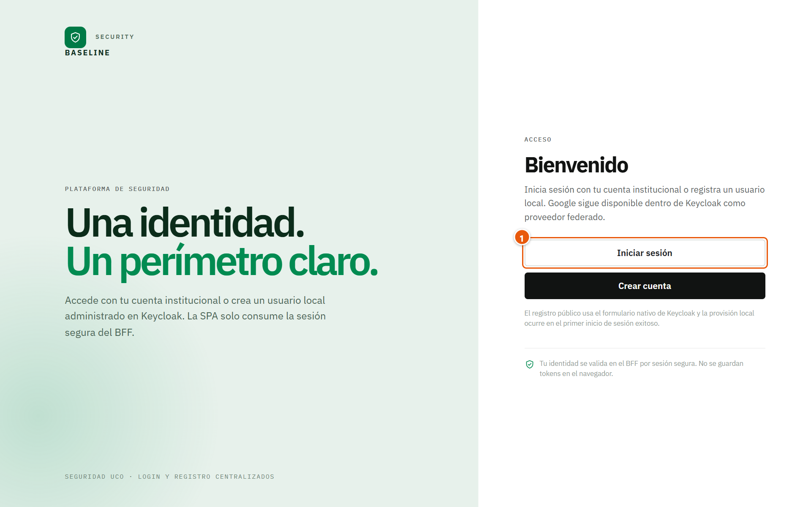

::: leyenda
1. **Iniciar sesión** — abre el inicio de sesión de Keycloak.
:::

3. Escribe tu usuario (correo) y tu contraseña y pulsa **Sign In**.

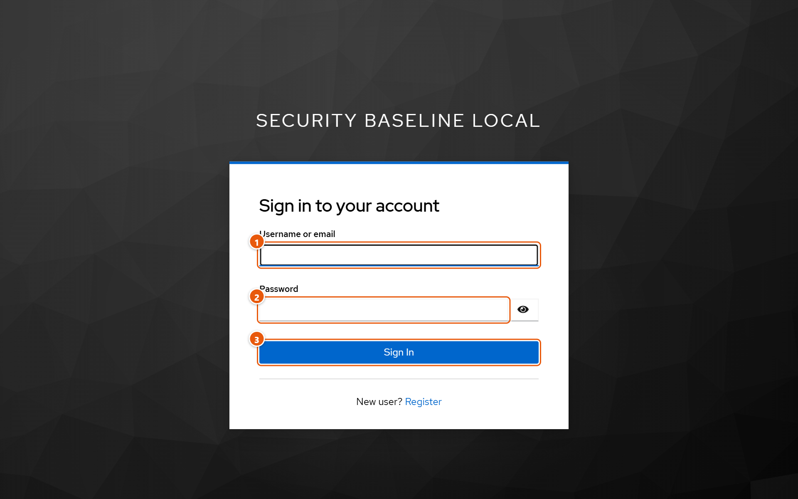

::: leyenda
1. **Usuario o correo** — el correo de tu cuenta de seguridad.
2. **Contraseña** — la contraseña de esa cuenta.
3. **Sign In** — entra y regresa a la pantalla de seguridad.
:::

### 2.2 Registrar la aplicación MessageUcoLab

1. En el menú de la izquierda pulsa **Aplicaciones**.
2. Pulsa **Registrar aplicación** (botón negro, arriba a la derecha).
3. Llena el formulario **exactamente** así:

| Campo | Qué escribir |
|---|---|
| Nombre de la aplicación | `MessageUcoLab` (exactamente así, con mayúsculas y minúsculas) |
| Descripción | `Catalogo de mensajes del semillero` |
| URL base | `http://localhost:8000` |
| Ambientes | Deja marcados **Desarrollo**, **Laboratorio** y **Producción** |

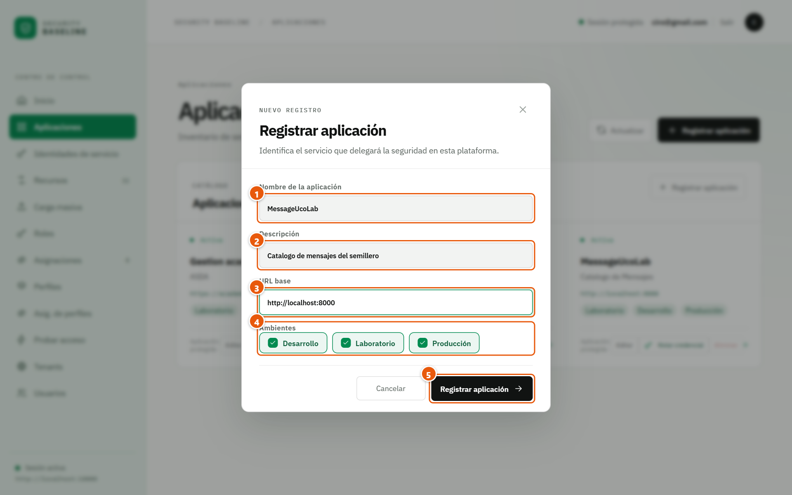

::: leyenda
1. **Nombre de la aplicación** — escribe exactamente `MessageUcoLab`.
2. **Descripción** — un texto corto, por ejemplo `Catalogo de mensajes del semillero`.
3. **URL base** — `http://localhost:8000`.
4. **Ambientes** — deja marcados Desarrollo, Laboratorio y Producción.
5. **Registrar aplicación** — guarda y muestra la credencial técnica una sola vez.
:::

4. Pulsa **Registrar aplicación**.

> **Cuidado:** al registrar, la pantalla muestra **una credencial técnica una sola vez**. Pulsa
> **Copiar** y pégala en un lugar temporal y seguro (por ejemplo un bloc de notas que no guardes). La
> vas a usar en el paso 3 como `PEP_REGISTRATION_TOKEN`. No la envíes por chat ni la subas a git.

5. Cierra la ventana de la credencial. La aplicación aparece en la lista:

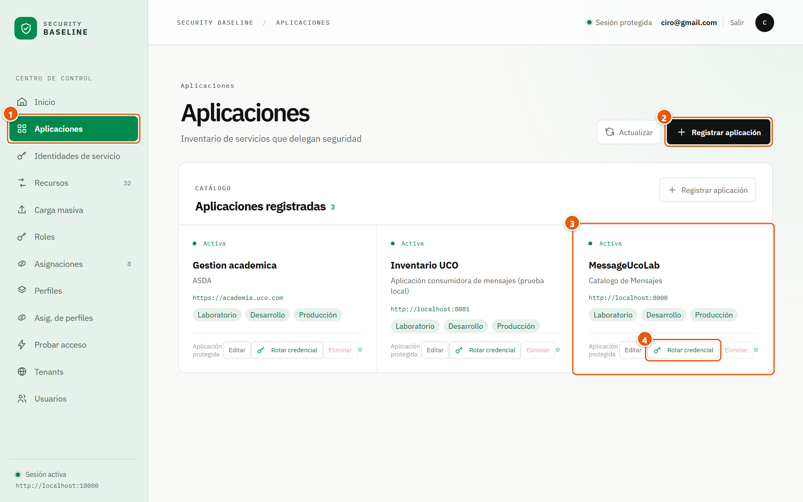

::: leyenda
1. **Aplicaciones** — opción del menú lateral para ver las aplicaciones registradas.
2. **Registrar aplicación** — abre el formulario del paso anterior.
3. **Tarjeta de MessageUcoLab** — confirma que quedó registrada y sus ambientes.
4. **Rotar credencial** — genera una credencial nueva si perdiste la anterior.
:::

> Si perdiste la credencial, pulsa **Rotar credencial** en la tarjeta de MessageUcoLab: se genera una
> nueva y la anterior deja de servir.

### 2.3 Cargar las rutas de MessageUcoLab (carga masiva)

MessageUcoLab tiene 33 rutas que deben quedar protegidas. No tienes que escribirlas: vienen en el
archivo **`recursos-messageucolab-0.3.0.xlsx`** que acompaña esta guía.

1. En el menú de la izquierda pulsa **Carga masiva**.
2. En **¿Qué quieres cargar?** abre la lista y elige **Cargar recursos** (1).

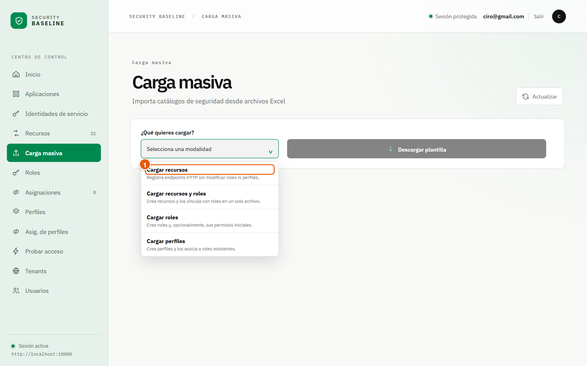

::: leyenda
1. **Cargar recursos** — la modalidad que registra rutas (recursos) nuevas.
:::

3. En **Paso 1**, arrastra el archivo `recursos-messageucolab-0.3.0.xlsx` al recuadro o púlsalo para elegirlo (1).
   Debe decir **listo para validar**.
4. Pulsa **Validar archivo** (2). Debe decir **33 filas · 33 válidas · 0 con errores**.
5. Pulsa **Confirmar carga**. Aparece el aviso de que se registraron los 33 recursos.

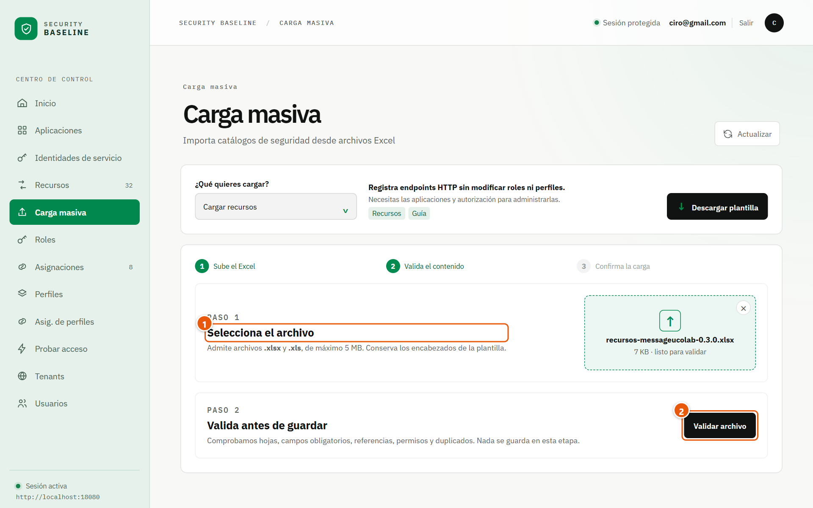

::: leyenda
1. **Archivo** — `recursos-messageucolab-0.3.0.xlsx`, listo para validar.
2. **Validar archivo** — revisa las 33 filas antes de crearlas; todavía no guarda nada.
:::

> No edites el Excel: el nombre de la aplicación de cada fila debe ser `MessageUcoLab`, igual que en
> el paso 2.2.

### 2.4 Crear el rol que podrá usar MessageUcoLab

1. En el menú de la izquierda pulsa **Roles**.
2. Pulsa **Definir rol**.
3. Llena así:

| Campo | Qué elegir |
|---|---|
| Nombre del rol | `Gestor de mensajes` (puedes usar otro nombre) |
| Alcance | **Aplicación** |
| Aplicación | **MessageUcoLab** |

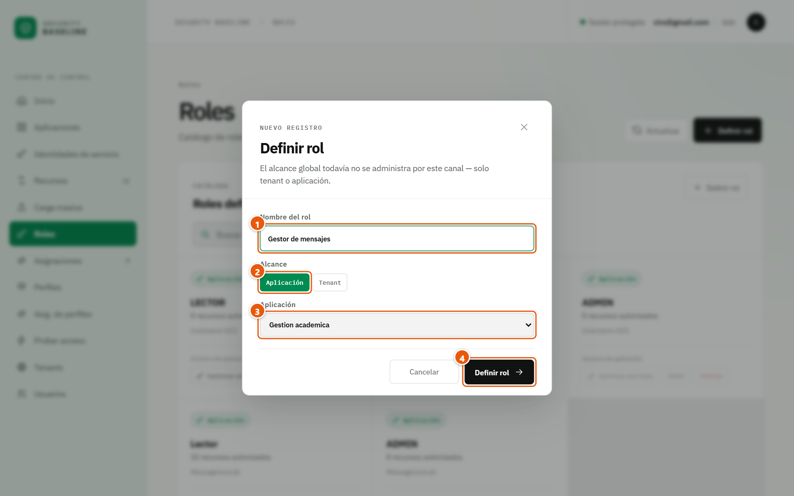

::: leyenda
1. **Nombre del rol** — por ejemplo `Gestor de mensajes`.
2. **Alcance** — deja seleccionado **Aplicación**.
3. **Aplicación** — elige `MessageUcoLab`.
4. **Definir rol** — crea el rol (todavía sin rutas).
:::

4. Pulsa **Definir rol**.

> Además de tu rol, verás un rol **ADMIN** creado automáticamente con la aplicación. Ese rol está
> protegido: no lo edites. Le da acceso a la pestaña **Seguridad** dentro de MessageUcoLab.

### 2.5 Darle las 33 rutas al rol

Todas las rutas se asignan juntas, con un solo botón:

1. En el menú de la izquierda pulsa **Roles**.
2. En la tarjeta de tu rol (`Gestor de mensajes`) pulsa **Gestionar permisos**.
3. En **Aplicación** elige **MessageUcoLab** y en **Rol** elige `Gestor de mensajes`. A la izquierda aparecen
   las rutas **Disponibles** y a la derecha las **Asignados al rol**.
4. Pulsa **Asignar visibles** (1). Las 33 rutas pasan al panel de la derecha.
5. Pulsa **Guardar cambios** (2). Al terminar, la tarjeta del rol dice **33 recursos autorizados**.

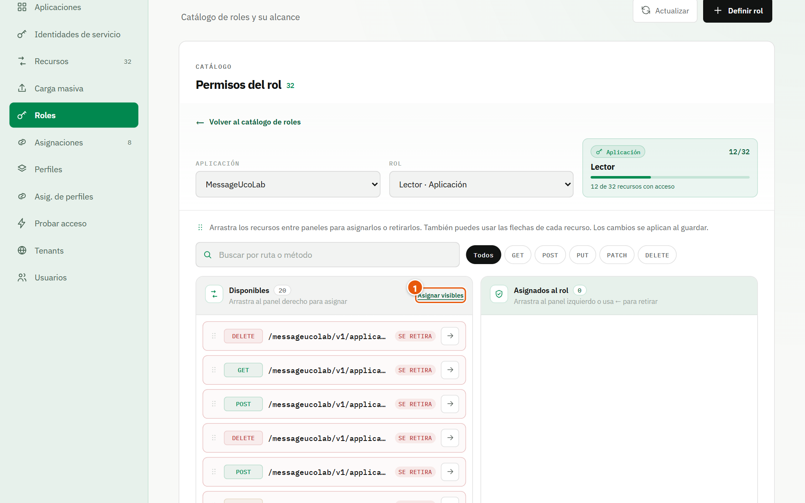

::: leyenda
1. **Asignar visibles** — pasa al rol todas las rutas de la lista.
2. **Guardar cambios** — aplica la asignación; sin este clic no se guarda nada.
:::

> Usa la lista del **Anexo B** como lista de chequeo.

### 2.6 Asignarte el rol

1. En el menú de la izquierda pulsa **Asignaciones**.
2. Pulsa **Asignar rol**.
3. Elige **Rol:** `Gestor de mensajes`, **Usuario:** tu correo y **Aplicación:** `MessageUcoLab`.

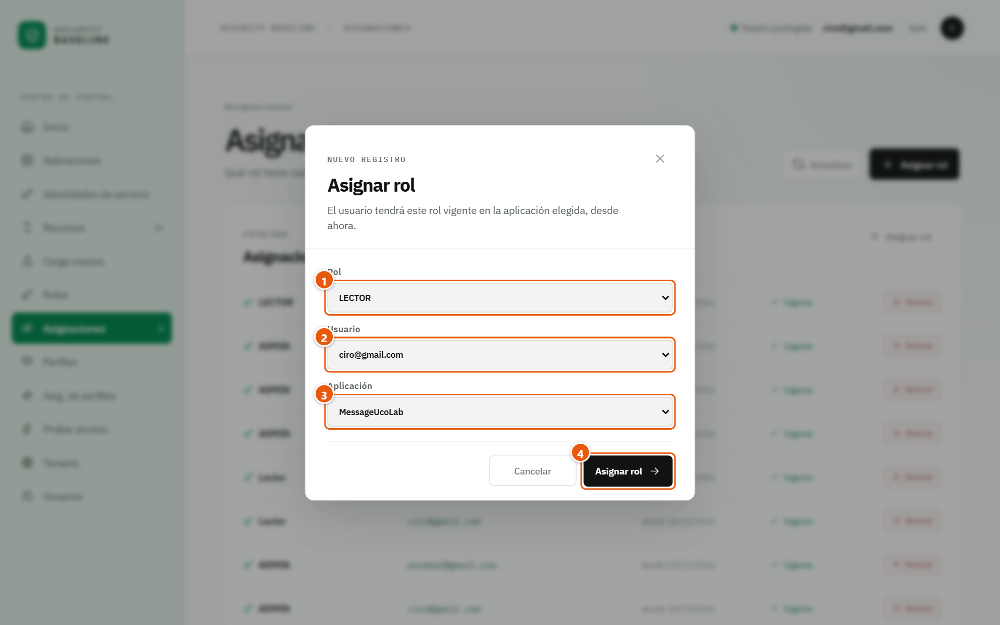

::: leyenda
1. **Rol** — `Gestor de mensajes` (y luego `ADMIN`).
2. **Usuario** — tu correo.
3. **Aplicación** — `MessageUcoLab`.
4. **Asignar rol** — te da el rol desde este momento.
:::

4. Pulsa **Asignar rol**.
5. Repite con el rol **ADMIN** si en la lista de **Asignaciones** no aparece ya asignado a tu correo.

**Cómo saber que quedó bien:** en **Asignaciones** ves tu correo con `Gestor de mensajes` y con `ADMIN`,
ambos **Vigente**.

---

## 3. Guardar los secretos en Doppler

En el semillero **ninguna contraseña se escribe en archivos**: todas viven en Doppler. Como la base de
datos y la caché corren en tu máquina, **tú inventas** sus contraseñas. El resto de la configuración
(puertos y direcciones) no es secreta y ya viene lista en la carpeta del paso 4.

### 3.1 Crear el proyecto y guardar los secretos

1. Entra a <https://dashboard.doppler.com> con tu cuenta.
2. Pulsa **Create Project** y llámalo `messageucolab-local`. Doppler crea la configuración `dev`.
3. Entra a la configuración **dev** y agrega estos **5 secretos** con **Add Secret**:

| Secreto | Qué poner |
|---|---|
| `SURREALDBUSER` | Un usuario para la base de datos, por ejemplo `admin` |
| `SURREALDBPASSWORD` | Una contraseña que inventes, de 16 caracteres o más |
| `REDISPASSWORD` | Otra contraseña que inventes, de 16 caracteres o más |
| `GF_SECURITY_ADMIN_PASSWORD` | Otra contraseña que inventes (es la del panel de métricas Grafana) |
| `PEP_REGISTRATION_TOKEN` | La credencial técnica que copiaste en el paso 2.2 |

4. Pulsa **Save**.
5. Borra la credencial del bloc de notas temporal: ya está guardada en Doppler.

### 3.2 Iniciar sesión en Doppler desde la terminal

Abre una terminal en cualquier carpeta e inicia sesión (solo la primera vez; se abre el navegador para
que confirmes):

```bash cwd=C:\…
doppler login
```

---

## 4. Descargar y levantar MessageUcoLab

MessageUcoLab se descarga **ya construido** desde Docker Hub, igual que el componente de seguridad: no
necesitas su código ni compilarlo. La pantalla de MessageUcoLab sí se descarga de GitHub y se levanta
con Node.

### 4.1 Preparar la carpeta

1. Crea una carpeta **fuera** del repositorio de tu aplicación, por ejemplo `messageucolab`.
2. Descomprime ahí el archivo **`messageucolab-local.zip`** que acompaña esta guía. Queda la carpeta
   `messageucolab-local` con estos archivos:

| Archivo | Para qué |
|---|---|
| `compose.yaml` | Los servicios de MessageUcoLab: la aplicación, su base de datos, la caché, Kong y Pulsar (la IA de traducción es opcional) |
| `.env` | Puertos, direcciones y la versión de la imagen. **No lleva contraseñas** |
| `kong.yaml`, `scripts\…` y los demás | Configuración que usan los servicios. No los modifiques |

3. Abre una terminal en la carpeta `messageucolab` y descarga la pantalla de MessageUcoLab:
   ```bash cwd=C:\…\messageucolab
   git clone -b develop https://github.com/migue8104/MessageUcolab--Frontend.git
   ```

### 4.2 Levantar el backend

1. Abre una terminal **dentro de `messageucolab-local`** y vincúlala con tu proyecto de Doppler (solo
   la primera vez):
   ```bash cwd=C:\…\messageucolab\messageucolab-local
   doppler setup --project messageucolab-local --config dev
   ```
2. Descarga y levanta todo. Elige **una** de las dos formas: la diferencia es el **perfil `ollama`**, que es el que
   descarga Ollama y su modelo de traducción (varios GB).

   **Sin traducción** (lo normal; **no** descarga Ollama). **No** pongas el perfil:
   ```bash cwd=C:\…\messageucolab\messageucolab-local
   doppler run -- docker compose -p messageucolab up -d
   ```
   **Con traducción.** Pon `--profile ollama` **antes** de `up`: así se descargan y se levantan Ollama y su
   modelo, dentro de Docker y sin instalar nada en tu PC:
   ```bash cwd=C:\…\messageucolab\messageucolab-local
   doppler run -- docker compose -p messageucolab --profile ollama up -d
   ```
   Mantén comentada la línea `# COMPOSE_PROFILES=ollama` del `.env`: con la línea activa, el perfil se aplicaría
   también cuando no lo escribes en el comando.

   La primera vez tarda entre 5 y 15 minutos (bastante más con traducción), según tu internet. Las siguientes
   veces arranca en segundos. Al terminar, en Docker Desktop → **Images**
   aparece la imagen de MessageUcoLab, `jciro17/messageucolab` con la etiqueta `0.3.0`; su contenedor se llama `messageucolab-app`.
3. Abre <http://localhost:8000/actuator/health> en el navegador. Si la página muestra
   `{"status":"UP"}`, el backend está funcionando. Es la misma dirección (`8000`) que usará tu
   aplicación en el paso 8.

| Si ves… | Qué hacer |
|---|---|
| Avisos `The "AZURE_CLIENT_ID" variable is not set` | Es normal: el almacén de secretos de Azure está apagado en local (`AZURE_KEYVAULT_ENABLED=false` en `.env`) |
| `Configure MESSAGEUCOLAB_DOCKER_ORG` | La terminal no está dentro de `messageucolab-local`, o falta el archivo `.env` |
| "No se puede acceder a este sitio" | Espera un minuto más y recarga |
| Un contenedor en estado **Exited** en Docker Desktop | Abre sus **Logs** y revisa que los 5 secretos existan en Doppler (paso 3.1) |
| `port is already allocated` | Otro programa usa ese puerto: ciérralo |

> **Cuidado:** `docker compose -p messageucolab down -v` **borra todos tus mensajes**. Para apagar sin
> perder nada usa `docker compose -p messageucolab down`.

### 4.3 Levantar la pantalla de MessageUcoLab

1. Abre **otra** terminal en la carpeta del frontend e instala sus dependencias (solo la primera vez):
   ```bash cwd=C:\…\messageucolab\MessageUcolab--Frontend
   npm install
   ```
2. Arráncala y **deja esa terminal abierta** mientras uses MessageUcoLab:
   ```bash cwd=C:\…\messageucolab\MessageUcolab--Frontend
   npm run dev
   ```
   Cuando muestre `Local: http://localhost:5174/`, la pantalla está lista.

> **Para actualizar:** cuando el equipo de MessageUcoLab publique una versión nueva, cambia
> `MESSAGEUCOLAB_VERSION` en el `.env` y repite el comando del paso 4.2 (con `--profile ollama` solo si usas traducción).
> Para la pantalla, ejecuta `git pull` en su carpeta y repite el paso 4.3.

---

## 5. Entrar a MessageUcoLab

1. Abre <http://localhost:5174>.
2. La primera vez verás **"Tu sesión se perdió"**. Es normal: todavía no has iniciado sesión. Pulsa
   **Volver a Conectar**.

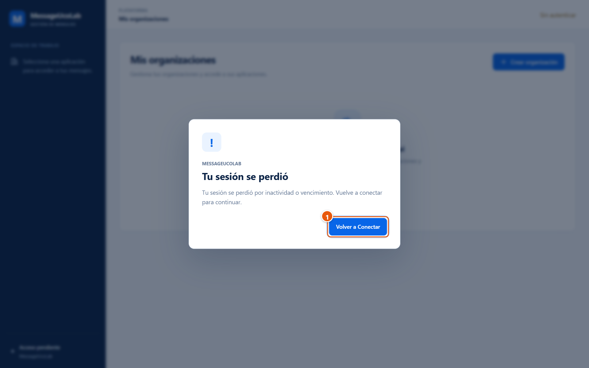

::: leyenda
1. **Volver a Conectar** — te lleva a iniciar sesión en el componente de seguridad y regresa a MessageUcoLab.
:::

3. Se abre la pantalla de seguridad. Pulsa **Iniciar sesión**; si ya habías entrado en el paso 2,
   Keycloak te reconoce y no vuelve a pedir la contraseña.
4. Regresas a MessageUcoLab y ves **Mis organizaciones**. Arriba a la derecha aparece tu correo.

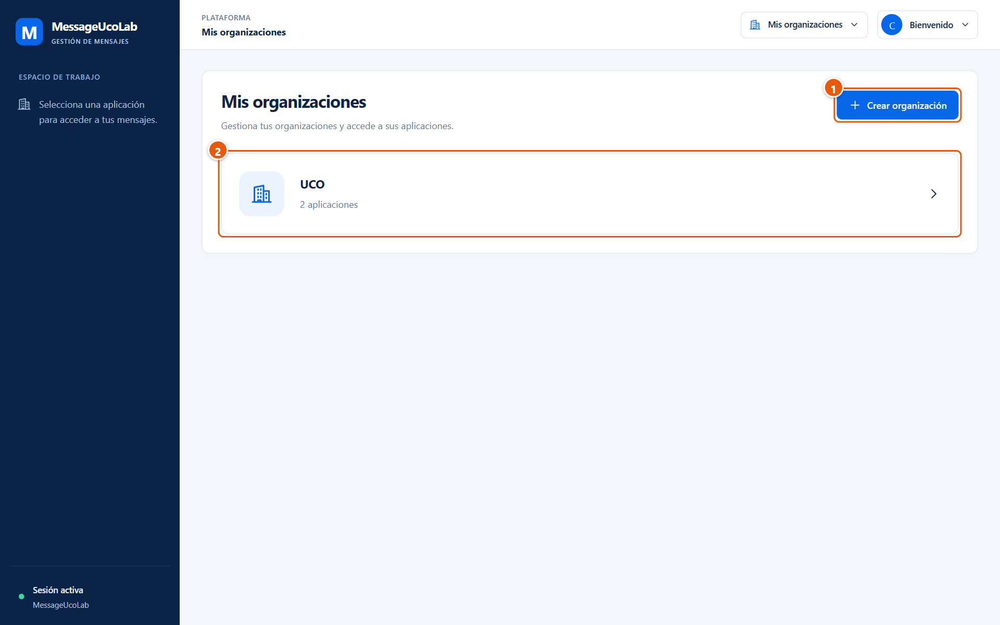

::: leyenda
1. **Crear organización** — crea un espacio para agrupar tus aplicaciones.
2. **Tarjeta de organización** — ábrela para ver sus aplicaciones.
:::

---

## 6. Crear tu organización, tu aplicación y tus mensajes

### 6.1 Crear tu organización

1. Pulsa **Crear organización**.
2. Escribe el nombre (por ejemplo `UCO`) y pulsa **Crear organización**.

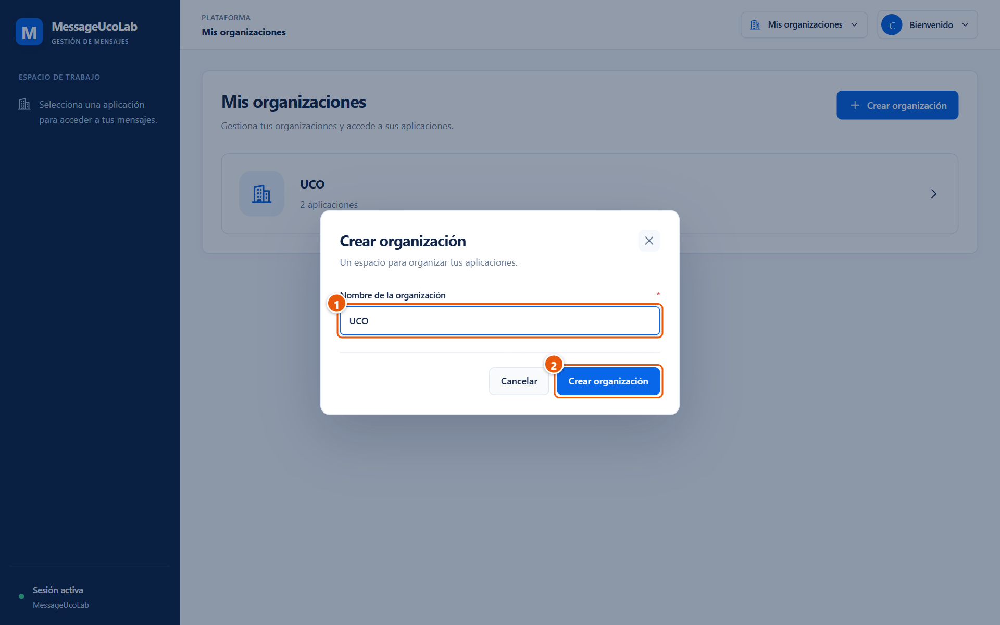

::: leyenda
1. **Nombre de la organización** — por ejemplo `UCO`.
2. **Crear organización** — la guarda; tú quedas como su dueño.
:::

### 6.2 Crear tu aplicación

1. Pulsa la tarjeta de tu organización.
2. Pulsa **Crear aplicación**.
3. Escribe el nombre de **tu** aplicación (por ejemplo `Asistencia UCO`), elige el **idioma base** y
   pulsa **Crear aplicación**.

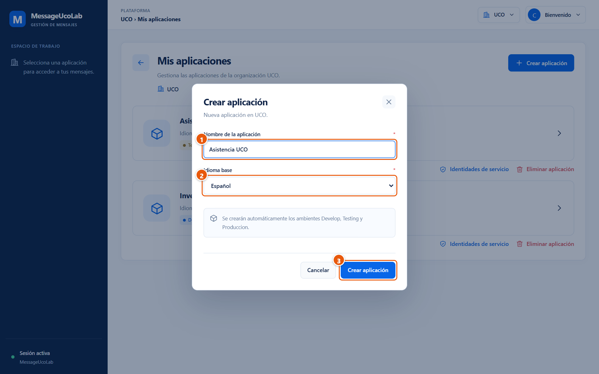

::: leyenda
1. **Nombre de la aplicación** — el nombre de **tu** aplicación.
2. **Idioma base** — el idioma en que escribes tus mensajes.
3. **Crear aplicación** — la crea con sus ambientes Develop, Testing y Produccion.
:::

4. La aplicación aparece con sus tres ambientes: **Develop**, **Testing** y **Produccion**.

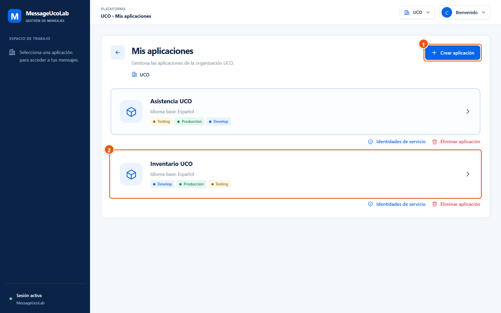

::: leyenda
1. **Crear aplicación** — abre el formulario del paso anterior.
2. **Tarjeta de la aplicación** — muestra sus ambientes; púlsala para administrar sus mensajes.
:::

### 6.3 Crear una funcionalidad

Una funcionalidad agrupa mensajes por tema (por ejemplo "Registro de asistencia").

1. Pulsa la tarjeta de tu aplicación. Se abre el menú de la izquierda.
2. Pulsa **Configuración** y baja hasta **Funcionalidades**.
3. Pulsa **Crear funcionalidad**, escribe el nombre, deja el estado **Activo** y pulsa
   **Crear funcionalidad**.

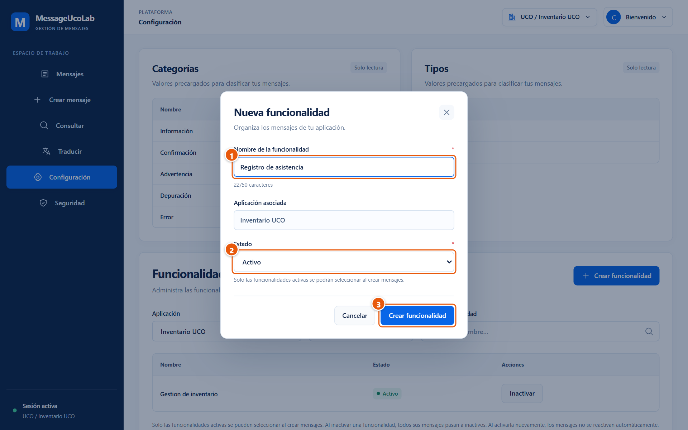

::: leyenda
1. **Nombre de la funcionalidad** — el tema que agrupa mensajes, por ejemplo `Registro de asistencia`.
2. **Estado** — deja **Activo**; solo las activas se pueden usar en mensajes.
3. **Crear funcionalidad** — la guarda.
:::

### 6.4 Crear tus mensajes

Antes de empezar, haz una lista de los textos que hoy están escritos en tu código: el código que les
vas a dar, el texto actual y dónde se usan. Luego créalos uno por uno:

1. Pulsa **Crear mensaje** en el menú de la izquierda.
2. En **Ambientes**, marca **Todos** (o solo los que vayas a usar).
3. En **Código**, escribe solo el final: `PRODSAVED` se guarda como `MSG_PRODSAVED`.
4. Elige la **Funcionalidad**, el **Tipo**, la **Categoría** y el **Estado** `Activo`.
5. Escribe el **Título** y el **Contenido**.
6. Pulsa **Crear mensaje**. Aparece "Mensaje creado en: Develop, Produccion, Testing".

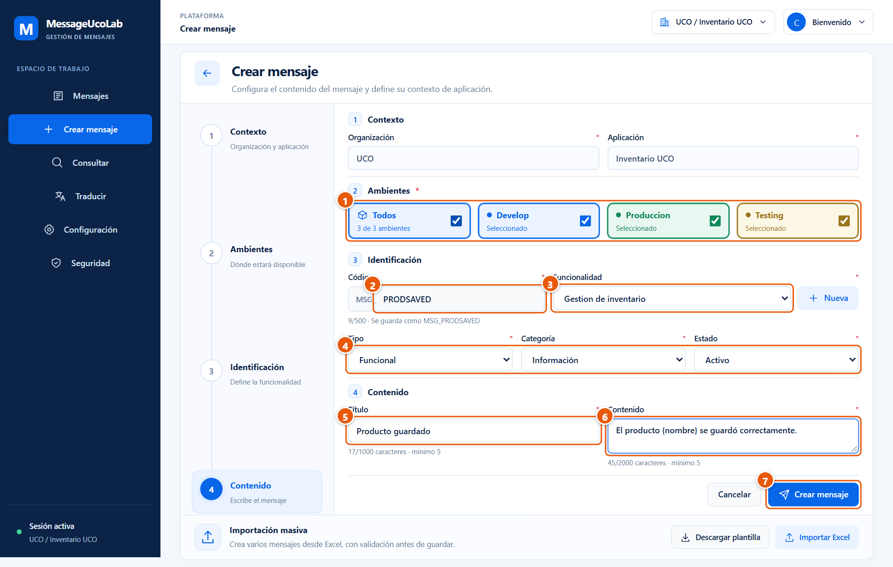

::: leyenda
1. **Ambientes** — marca **Todos** o solo los que vayas a usar.
2. **Código** — solo el final; `PRODSAVED` se guarda como `MSG_PRODSAVED`.
3. **Funcionalidad** — el tema al que pertenece el mensaje.
4. **Tipo, categoría y estado** — deja el estado en **Activo** para que se entregue.
5. **Título** — entre 5 y 1000 caracteres.
6. **Contenido** — entre 5 y 2000 caracteres; puede tener marcadores como `{nombre}`.
7. **Crear mensaje** — lo guarda en los ambientes marcados.
:::

| Campo | Regla |
|---|---|
| Código | Hasta 500 caracteres después de `MSG_`. Es único dentro de tu aplicación |
| Título | Entre 5 y 1000 caracteres |
| Contenido | Entre 5 y 2000 caracteres. Puede tener marcadores como `{nombre}` |
| Estado | Solo los mensajes **Activo** se entregan a tu aplicación |

> Los **marcadores** como `{nombre}` permiten mensajes dinámicos. MessageUcoLab los entrega tal cual y
> tu aplicación los reemplaza con el dato real (paso 8).

> Tu backend leerá **solo** los mensajes del ambiente que elijas en el paso 7.4 (por ejemplo, Develop): crea
> los mensajes en ese ambiente.

### 6.5 Importar varios mensajes desde Excel

Si tienes muchos textos, no tienes que crearlos uno por uno: llenas una plantilla de Excel, la subes y
MessageUcoLab revisa **todo el archivo antes de guardar**. Mientras no confirmes, no se crea ningún
mensaje.

**Descargar la plantilla**

1. Pulsa **Crear mensaje** en el menú de la izquierda.
2. Abajo del formulario, en la franja **Importación masiva**, pulsa **Descargar plantilla** (1). Se
   descarga `plantilla-mensajes.xlsx`, preparada para la aplicación que tienes abierta.

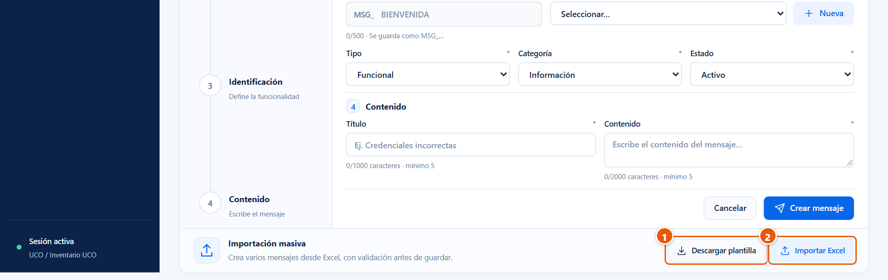

::: leyenda
1. **Descargar plantilla** — baja el Excel con las listas de tu aplicación.
2. **Importar Excel** — abre el asistente para subir el archivo lleno.
:::

**Llenar la plantilla**

3. Abre el Excel y llena **solo** la hoja **Mensajes**: una fila por mensaje, desde la fila 2. No
   cambies los encabezados ni las otras hojas.
4. En **Funcionalidad**, **Tipo**, **Categoría** y **Estado** elige el valor de la lista desplegable de
   cada celda. Así queda escrito exactamente como lo espera MessageUcoLab.

| Código | Funcionalidad | Tipo | Categoría | Estado | Título | Contenido |
|---|---|---|---|---|---|---|
| `INICIO` | Gestion de inventario | Funcional | Información | Activo | Inicio de sesión exitoso | Bienvenido de nuevo, {nombre}. |
| `PRODBAJA` | Gestion de inventario | Funcional | Confirmación | Activo | Producto eliminado | El producto {nombre} se eliminó correctamente. |
| `STOCKBAJO` | Gestion de inventario | Funcional | Advertencia | Activo | Quedan pocas unidades | Quedan pocas unidades de {nombre} en bodega. |

| Regla | Detalle |
|---|---|
| Código | Sin `MSG_`: `INICIO` se guarda como `MSG_INICIO`. De 1 a 500 caracteres y que **no exista** ya en tu aplicación |
| Listas | Funcionalidad, tipo, categoría y estado deben ser **idénticos** al desplegable (mayúsculas y tildes incluidas) |
| Funcionalidad | Debe existir y estar activa. La importación **no** crea funcionalidades: créalas antes (paso 6.3) |
| Título y contenido | Las mismas reglas del paso 6.4: título de 5 a 1000 caracteres y contenido de 5 a 2000 |
| Archivo | Solo `.xlsx`, máximo **500 mensajes** y **5 MB**, sin fórmulas, macros ni enlaces externos |
| Ambientes | **No** van en el Excel: se eligen al subir el archivo y aplican a todas las filas |

> La plantilla es de **una sola aplicación**. Si cambias de aplicación arriba a la derecha, descarga
> una plantilla nueva.

**Subir y validar**

5. Pulsa **Importar Excel**. En el asistente, marca los **ambientes** donde quedarán los mensajes (1),
   arrastra el archivo o pulsa **Elegir archivo** (2) y pulsa **Validar archivo** (3).

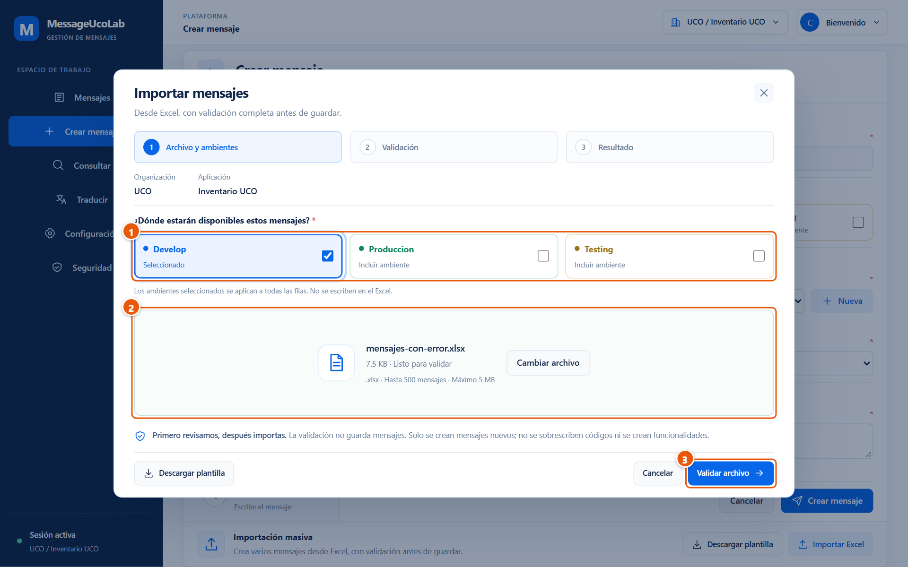

::: leyenda
1. **Ambientes** — Develop viene marcado; marca también los demás que vayas a usar.
2. **Archivo** — arrastra aquí tu Excel o pulsa **Elegir archivo**.
3. **Validar archivo** — revisa todas las filas; todavía no guarda nada.
:::

6. MessageUcoLab muestra cuántas filas están bien y cuántas tienen errores. Si alguna tiene errores,
   pulsa **Ver detalle** en esa fila para saber qué corregir, o **Descargar errores** para bajar un
   Excel con todos los errores juntos.

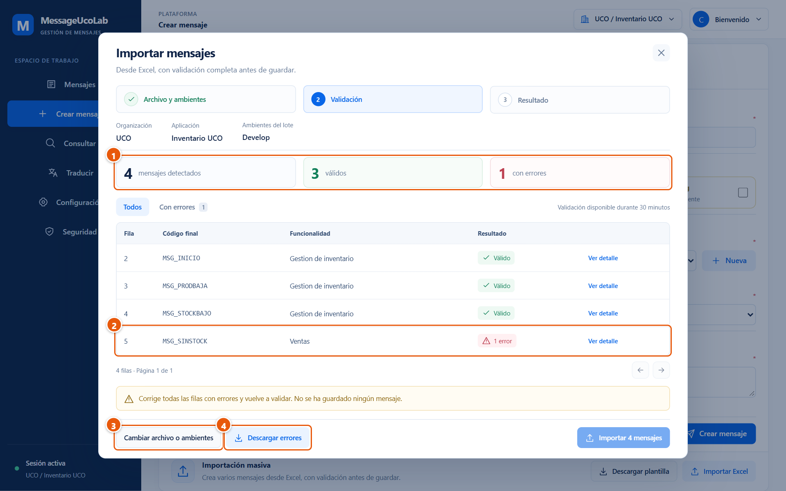

::: leyenda
1. **Resumen** — mensajes detectados, válidos y con errores.
2. **Fila con errores** — pulsa **Ver detalle** para ver qué falló.
3. **Cambiar archivo o ambientes** — vuelve al paso 1 para subir el Excel corregido.
4. **Descargar errores** — baja un Excel con el error de cada fila.
:::

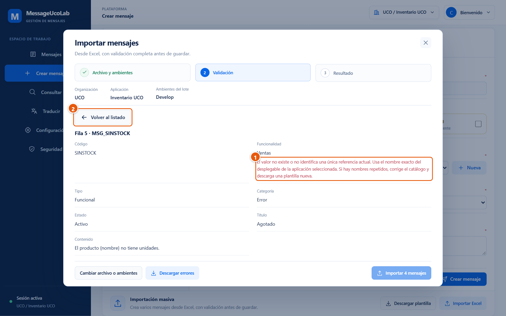

::: leyenda
1. **Error en Funcionalidad** — `Ventas` no existe en la aplicación; elige un valor de la lista.
2. **Volver al listado** — regresa a la tabla de filas.
:::

7. Corrige el Excel, pulsa **Cambiar archivo o ambientes**, sube el archivo corregido y pulsa
   **Validar archivo** otra vez. El botón para importar solo se habilita cuando **todas** las filas
   están bien.

**Confirmar la importación**

8. Con **0 con errores**, pulsa **Importar N mensajes** (N es la cantidad de filas). Si marcaste
   **Produccion**, primero debes marcar la casilla que confirma que también se crearán ahí.

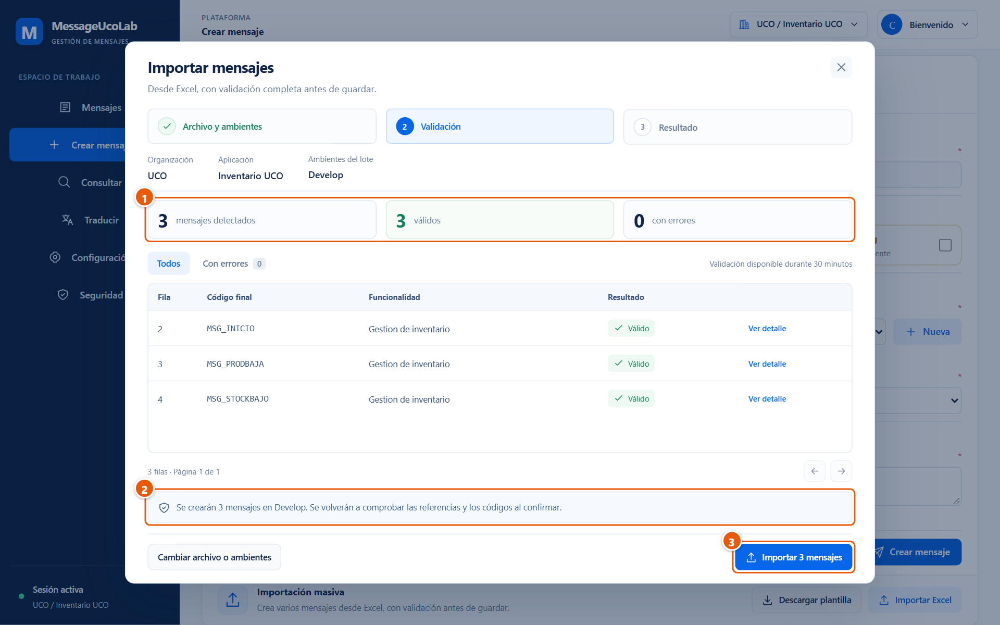

::: leyenda
1. **Resumen** — todas las filas válidas y **0 con errores**.
2. **Aviso** — cuántos mensajes se crearán y en qué ambientes.
3. **Importar N mensajes** — crea todos los mensajes de una vez.
:::

9. El asistente muestra **N mensajes importados** con los ambientes del lote. Pulsa **Ver mensajes**
   para verlos en la lista.

> Se guardan **todos o ninguno**: si al confirmar falla una fila, no se crea ningún mensaje del lote.
> La validación dura **30 minutos**; si pasa más tiempo, vuelve a validar el archivo.

> La importación **solo crea mensajes nuevos**. Para cambiar un mensaje que ya existe, edítalo desde
> **Mensajes**.

### 6.6 Comprobar tus mensajes

En **Mensajes** ves la lista; en **Consultar** escribes un código y ves su detalle y sus ambientes.

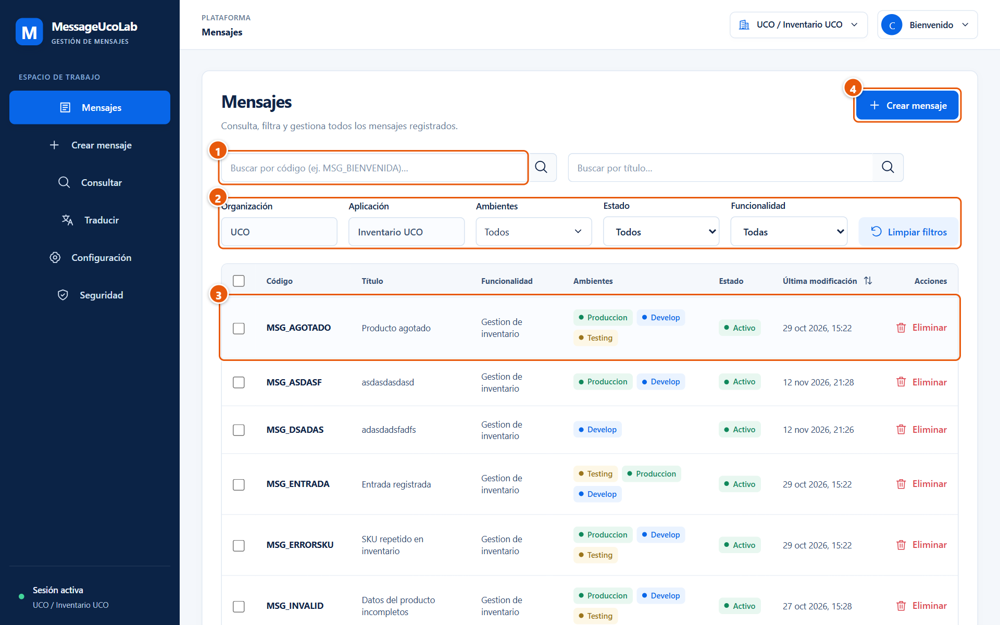

::: leyenda
1. **Buscar por código** — encuentra un mensaje por su código.
2. **Filtros** — por ambiente, estado o funcionalidad; **Limpiar filtros** los quita.
3. **Fila del mensaje** — código, título, ambientes y estado; púlsala para ver el detalle.
4. **Crear mensaje** — abre el formulario de un mensaje nuevo.
:::

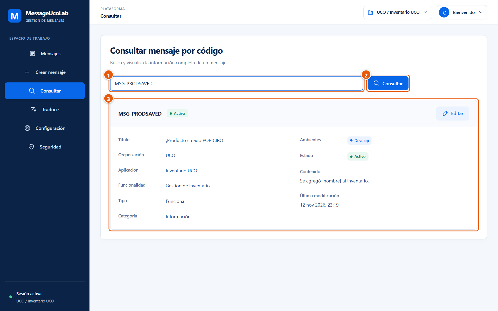

::: leyenda
1. **Código del mensaje** — escribe el código completo, por ejemplo `MSG_PRODSAVED`.
2. **Consultar** — busca el mensaje.
3. **Detalle** — título, contenido, ambientes y estado tal como los recibirá tu aplicación.
:::

---

## 7. Darle una identidad a tu aplicación

Tu backend no es una persona, así que no entra a MessageUcoLab con un usuario y una contraseña: entra con una
**identidad de servicio**, un "usuario para máquinas" con dos datos, el **Client ID** (su nombre) y el
**secreto** (su clave). Se configura en cuatro partes cortas, siempre en este orden:

| Parte | Qué resuelve | Dónde |
|---|---|---|
| 7.1 Crear la identidad | Quién es tu backend | Seguridad, <http://localhost:5173> |
| 7.2 Pedir el permiso | Qué puede hacer: leer mensajes | Seguridad, <http://localhost:5173> |
| 7.3 Aprobar el permiso | Que se autorice (lo apruebas tú) | Seguridad, <http://localhost:5173> |
| 7.4 Elegir el ambiente | Qué mensajes lee: Develop, Testing o Produccion | MessageUcoLab, <http://localhost:5174> |

Los ejemplos usan la aplicación `Inventario UCO`, la identidad `inventario-dev` y el ambiente `Develop`; cambia
el nombre de la aplicación por el de la tuya.

> **Una identidad = un ambiente.** Para leer los mensajes de Testing, repite las cuatro partes con otra
> identidad, por ejemplo `inventario-test`.

### 7.1 Crear la identidad

En <http://localhost:5173>, entra a **Identidades de servicio** en el menú de la izquierda.

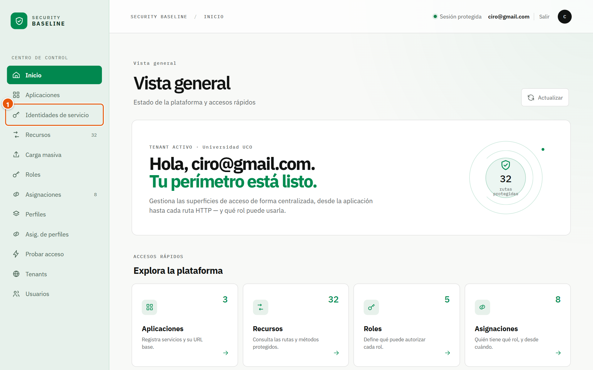

::: leyenda
1. **Identidades de servicio** — donde se crean las identidades y se piden sus permisos.
:::

En la pestaña **Identidades**, elige tu aplicación y pulsa **Crear identidad**.

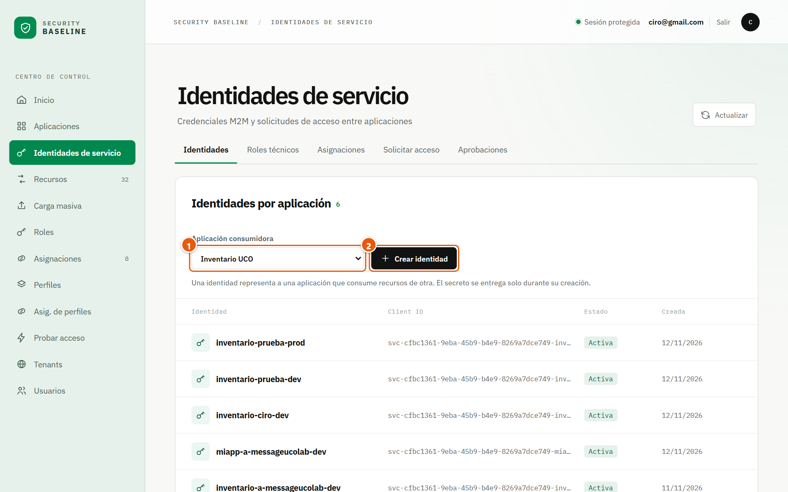

::: leyenda
1. **Aplicación consumidora** — la aplicación que va a leer mensajes.
2. **Crear identidad** — abre la ventana para ponerle nombre.
:::

Escribe el nombre (solo minúsculas, números y guiones) y confírmalo.

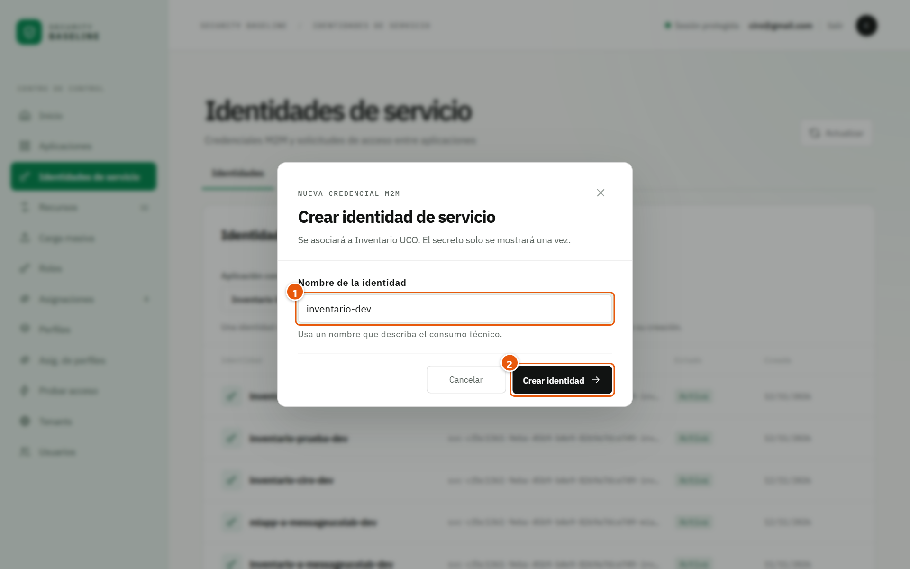

::: leyenda
1. **Nombre de la identidad** — `inventario-dev`.
2. **Crear identidad** — la crea y genera su secreto.
:::

Aparece el **secreto**. Cópialo y guárdalo ya en un bloc de notas.

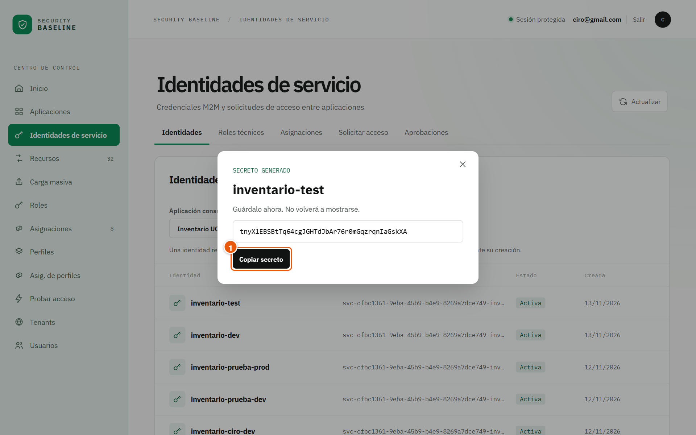

::: leyenda
1. **Copiar secreto** — copia la clave. En tu pantalla verás el nombre de tu identidad en lugar del de la imagen.
:::

> **Cuidado:** esta ventana **no se vuelve a abrir**. Si la cierras sin copiar el secreto, tendrás que crear
> otra identidad.

Cierra la ventana. En la lista, copia el **Client ID** de tu identidad (triple clic sobre él y **Ctrl+C**) y
guárdalo junto al secreto.

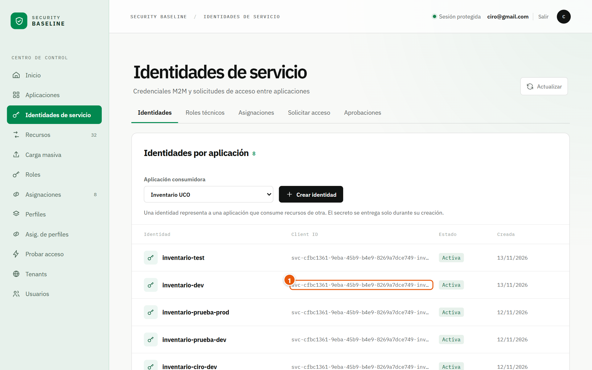

::: leyenda
1. **Client ID** — empieza por `svc-`; en pantalla se ve cortado, pero se copia completo.
:::

### 7.2 Pedir el permiso de lectura

En la pestaña **Solicitar acceso**, llena las cinco listas de arriba hacia abajo como en la imagen y pulsa
**Enviar solicitud**. El formulario se vacía cuando se envía.

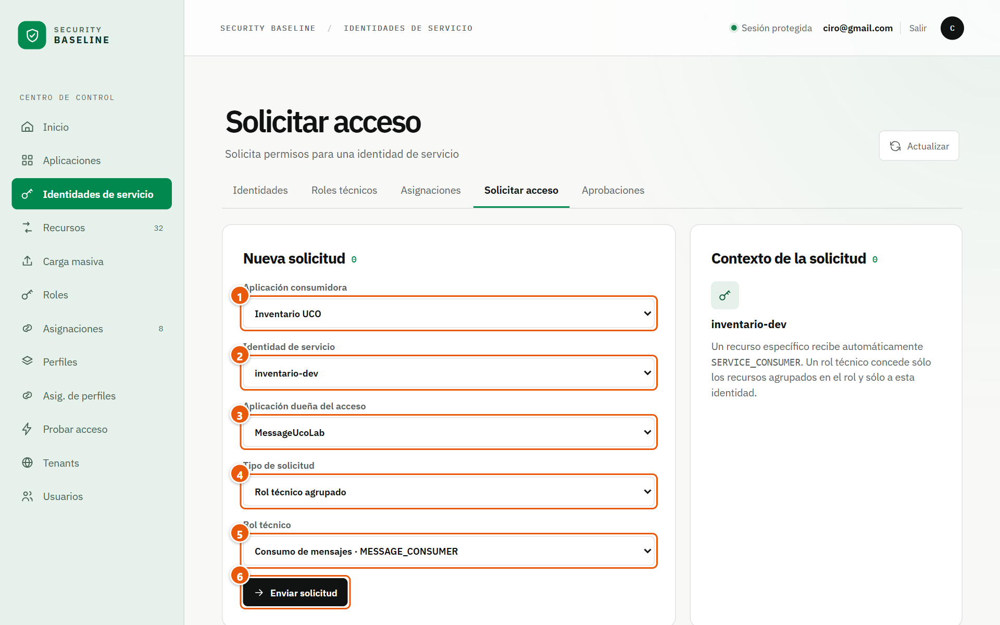

::: leyenda
1. **Aplicación consumidora** — tu aplicación.
2. **Identidad de servicio** — la que creaste en 7.1.
3. **Aplicación dueña del acceso** — siempre `MessageUcoLab`.
4. **Tipo de solicitud** — `Rol técnico agrupado`.
5. **Rol técnico** — `Consumo de mensajes · MESSAGE_CONSUMER`.
6. **Enviar solicitud** — la deja pendiente de aprobación.
:::

### 7.3 Aprobar el permiso

En la pestaña **Aprobaciones**, elige **MessageUcoLab** y pulsa **Aprobar** en la solicitud. Si no la ves,
pulsa **Actualizar**: la lista no se refresca sola.

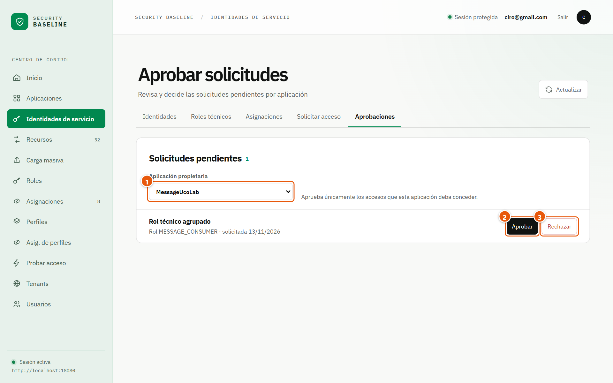

::: leyenda
1. **Aplicación propietaria** — `MessageUcoLab`.
2. **Aprobar** — concede el permiso de lectura.
3. **Rechazar** — no lo concede; no lo pulses.
:::

En **Asignaciones**, con tu aplicación y tu identidad, la fila `MESSAGE_CONSUMER` debe decir **Aprobada**.

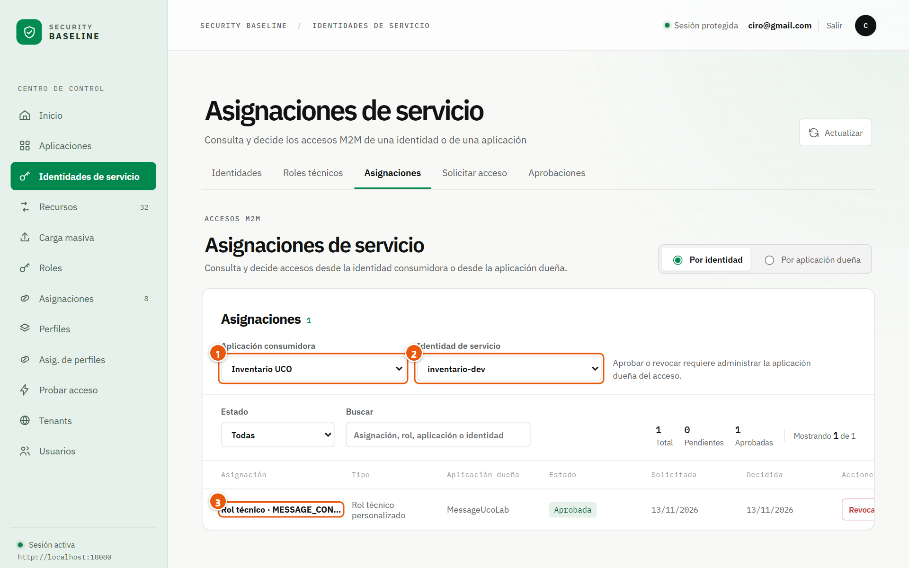

::: leyenda
1. **Aplicación consumidora** — tu aplicación.
2. **Identidad de servicio** — tu identidad.
3. **Fila del permiso** — `MESSAGE_CONSUMER`, **Aprobada**.
:::

### 7.4 Elegir el ambiente que lee la identidad

En <http://localhost:5174>, entra a tu organización y pulsa **Identidades de servicio** debajo de la tarjeta
de tu aplicación.

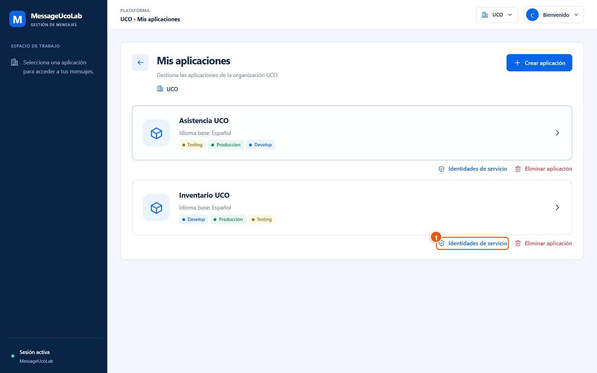

::: leyenda
1. **Identidades de servicio** — asocia una identidad a un ambiente de esta aplicación.
:::

Elige el ambiente, pega el **Client ID** (no el secreto) y pulsa **Registrar**.

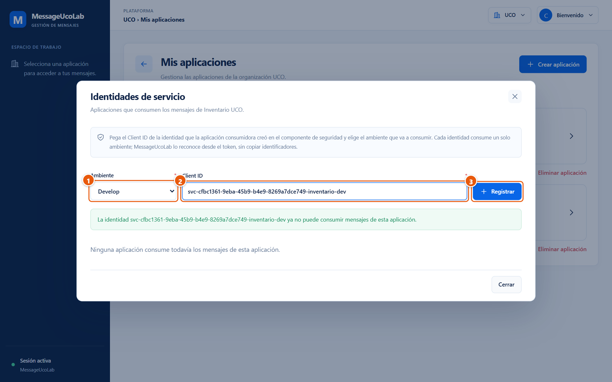

::: leyenda
1. **Ambiente** — el que va a leer tu backend, por ejemplo `Develop`.
2. **Client ID** — el que empieza por `svc-`.
3. **Registrar** — asocia la identidad al ambiente.
:::

Tu identidad aparece en la lista con su ambiente al lado. Listo: tu backend ya está autorizado.

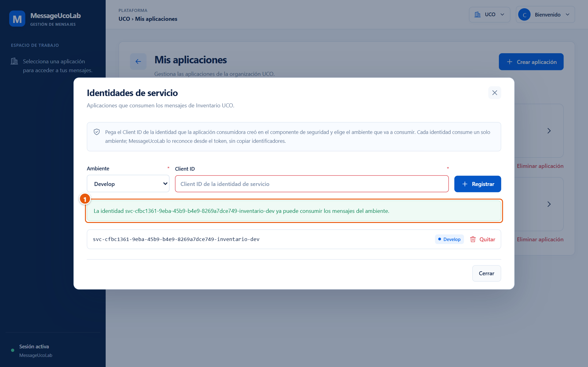

::: leyenda
1. **Identidad registrada** — el Client ID con su ambiente.
:::

---

## 8. Conectar tu backend

MessageUcoLab entrega una dependencia para Spring Boot, **messageucolab-spring-boot-starter**. Con ella tu
backend pide cada mensaje por su código, con una sola línea, y la dependencia se encarga de entrar con la
identidad del paso 7: pide el token, lo guarda y lo renueva sola.

Tu backend necesita **Java 25** y **Spring Boot 4.1.1** (en su `pom.xml` y en la imagen base de su `Dockerfile`),
porque es lo que exige la dependencia del componente de seguridad.

### 8.1 Agregar las dependencias en el pom.xml

Cambian las versiones y se agregan **dos repositorios y dos dependencias**. A la izquierda, cómo está hoy;
a la derecha, cómo queda. En **rojo**, lo que se quita o se reemplaza; en **verde**, lo que queda en su lugar:

::: comparar
```xml Antes · pom.xml
<parent>
  <groupId>org.springframework.boot</groupId>
  <artifactId>spring-boot-starter-parent</artifactId>
-|  <version>3.2.5</version>
  <relativePath/>
</parent>

<properties>
-|  <java.version>17</java.version>
</properties>


<dependencies>
  <dependency>
    <groupId>org.springframework.boot</groupId>
    <artifactId>spring-boot-starter-webflux</artifactId>
  </dependency>
  <!-- tus demás dependencias, sin cambios -->


</dependencies>
```
```xml Después · pom.xml
<parent>
  <groupId>org.springframework.boot</groupId>
  <artifactId>spring-boot-starter-parent</artifactId>
+|  <version>4.1.1</version>
  <relativePath/>
</parent>

<properties>
+|  <java.version>25</java.version>
</properties>

+|<repositories>
+|  <repository>
+|    <id>github-messageucolab</id>
+|    <url>https://maven.pkg.github.com/CamiloGarcia09/MessageUcolab--Backend</url>
+|  </repository>
+|  <repository>
+|    <id>github-seguridad</id>
+|    <url>https://maven.pkg.github.com/seguridad-uco/securitybaseline</url>
+|  </repository>
+|</repositories>

<dependencies>
  <dependency>
    <groupId>org.springframework.boot</groupId>
    <artifactId>spring-boot-starter-webflux</artifactId>
  </dependency>
  <!-- tus demás dependencias, sin cambios -->
+|  <dependency>
+|    <groupId>co.edu.uco</groupId>
+|    <artifactId>messageucolab-spring-boot-starter</artifactId>
+|    <version>0.1.3</version>
+|  </dependency>
+|  <dependency>
+|    <groupId>co.edu.uco</groupId>
+|    <artifactId>security-pep-integration-spring-boot-starter</artifactId>
+|    <version>0.1.4</version>
+|  </dependency>
</dependencies>
```
:::

- **Las dos dependencias.** La primera es el cliente de MessageUcoLab (`MessageReader`); la segunda es la del
  componente de seguridad, que entrega el token de tu identidad.
- **Los dos `<id>` de los repositorios.** Cada repositorio necesita un `<id>` **distinto**: si repites el mismo,
  Maven no abre el `pom.xml`. Las dos dependencias están en GitHub Packages y Maven las descarga con tu usuario
  de GitHub y un token con el permiso `read:packages` (el mismo para los dos repositorios).

**Dónde van el usuario y el token.** Tu imagen de Docker ya descarga la dependencia de seguridad de GitHub
Packages cuando se construye, con el `settings.xml` que le pasas a la construcción. En ese mismo archivo agrega un
`<server>` por cada `<id>`, con el mismo usuario y el mismo token:

```xml file=settings.xml
<settings>
  <servers>
    <server>
      <id>github-messageucolab</id>
      <username>${env.GITHUB_PACKAGES_USER}</username>
      <password>${env.GITHUB_PACKAGES_TOKEN}</password>
    </server>
    <server>
      <id>github-seguridad</id>
      <username>${env.GITHUB_PACKAGES_USER}</username>
      <password>${env.GITHUB_PACKAGES_TOKEN}</password>
    </server>
  </servers>
</settings>
```

Las credenciales **nunca** van en el `pom.xml` ni en la imagen. Si tu `Dockerfile` todavía no recibe el
`settings.xml`, mira cómo lo hace MessageUcoLab en su `Dockerfile`: lo recibe como secreto de construcción
(`--mount=type=secret`).

### 8.2 Configurar tu aplicación

Son tres archivos: `application.yml` y `docker-compose.yml`, que se suben a Git, y `.env`, que guarda el Client ID
y el secreto y **no** se sube.

**1. `application.yml`.** Se agregan los bloques `messageucolab` y `security`. Los valores llegan del `.env`:

::: comparar
```yaml Antes · application.yml
server:
  port: 8081

spring:
  application:
    name: inventario-webflux


```
```yaml Después · application.yml
server:
  port: 8081

spring:
  application:
    name: inventario-webflux

+|messageucolab:
+|  url: ${MESSAGEUCOLAB_URL}
+|
+|security:
+|  enabled: false
+|  pep:
+|    service-identity:
+|      enabled: true
+|      token-uri: ${KEYCLOAK_TOKEN_URI}
+|      client-id: ${MESSAGEUCOLAB_CLIENT_ID}
+|      client-secret: ${MESSAGEUCOLAB_CLIENT_SECRET}
```
:::

`security.enabled: false` deja sin proteger las rutas de **tu** aplicación (déjalo así si todavía no las
proteges); la identidad de servicio funciona igual.

**2. `.env`.** Créalo junto a tu `docker-compose.yml`. Este es el de la identidad de prueba de esta guía; las
direcciones son las que ve tu contenedor:

```properties file=.env
MESSAGEUCOLAB_URL=http://host.docker.internal:8000
MESSAGEUCOLAB_CLIENT_ID=svc-cfbc1361-9eba-45b9-b4e9-8269a7dce749-inventario-dev
MESSAGEUCOLAB_CLIENT_SECRET=pV8iAhnFGcuk8vL2oS-I0_SeooMrroKmie-clxOo2UQ
KEYCLOAK_TOKEN_URI=http://keycloak.localhost:19090/realms/security-baseline/protocol/openid-connect/token
```

> **Cuidado:** agrega `.env` a tu `.gitignore` antes de hacer commit. El secreto nunca va en Git ni en el
> código. Si tu equipo usa Doppler u otro gestor de secretos, define allí estas mismas variables.

**3. `docker-compose.yml`.** En el servicio de tu backend se agregan dos cosas: que lea el `.env` y que
`keycloak.localhost` apunte a tu PC, donde corre Keycloak.

::: comparar
```yaml Antes · docker-compose.yml
services:
  inventario:
    build: .
    ports:
      - "8081:8081"


```
```yaml Después · docker-compose.yml
services:
  inventario:
    build: .
    ports:
      - "8081:8081"
+|    env_file: .env
+|    extra_hosts:
+|      - "keycloak.localhost:host-gateway"
```
:::

Vuelve a construir y a levantar tu backend:

```bash cwd=C:\…\tu-backend
docker compose up -d --build
```

### 8.3 Pedir los mensajes en tu código

La dependencia registra sola un `MessageReader`: inyéctalo por el constructor donde hoy armas el texto y
pide el mensaje con `getDetails("CÓDIGO")`. Devuelve un `Mono<MessageDetails>`, que tu controlador entrega
tal cual a la pantalla.

`MessageReader` tiene **tres métodos**:

| Método | Devuelve | Para qué sirve |
|---|---|---|
| `getDetails(String code)` | `Mono<MessageDetails>` | **Un mensaje** por su código, en el idioma base de tu aplicación. Es el que reemplaza cada valor de tu enum |
| `getDetails(String code, String language)` | `Mono<MessageDetails>` | **Un mensaje traducido** al idioma que pidas (`en`, `pt`…). Solo traduce si MessageUcoLab tiene la traducción activada |
| `getAll()` | `Mono<MessageCollection>` | **Todos los mensajes** activos de tu aplicación en ese ambiente, de una sola vez |

```java
messageReader.getDetails("MSG_PRODSAVED");          // un mensaje, en el idioma base
messageReader.getDetails("MSG_PRODSAVED", "en");    // el mismo mensaje, en inglés
messageReader.getAll();                             // todos los mensajes de tu aplicación
```

Para **reemplazar tu enum** usa `getDetails(code)`: un código, un mensaje. Así cambia el código de un backend
que hoy tiene sus textos en un enum. **A la izquierda**, lo que la mayoría tiene hoy; **a la derecha**, cómo
queda:


**1. El servicio**, donde hoy se arma el texto:

::: comparar
```java Antes · InventarioService.java
package co.edu.uco.inventario.service;

-|import co.edu.uco.inventario.model.Aviso;
-|import co.edu.uco.inventario.model.MensajeEnum;
import co.edu.uco.inventario.model.Producto;
import org.springframework.stereotype.Service;
import reactor.core.publisher.Mono;


import java.util.List;

import java.util.concurrent.CopyOnWriteArrayList;

@Service
public class InventarioService {

    private final List<Producto> productos =
            new CopyOnWriteArrayList<>();


-|    public Mono<Aviso> guardar(Producto producto) {

        if (esInvalido(producto)) {
-|            MensajeEnum m = MensajeEnum.MSG_INVALID;
-|            return Mono.just(new Aviso(m.getTitulo(),
-|                    m.getContenido()));
        }
        productos.add(producto);
-|        MensajeEnum m = MensajeEnum.MSG_PRODSAVED;
-|        return Mono.just(new Aviso(m.getTitulo(),
-|                m.getContenido().replace("{nombre}",
-|                        producto.getNombre())));
    }

    private boolean esInvalido(Producto p) {
        // tu validación, sin cambios
    }
}
```
```java Después · InventarioService.java
package co.edu.uco.inventario.service;

import co.edu.uco.inventario.model.Producto;
+|import co.edu.uco.messageucolab.client.api.MessageReader;
+|import co.edu.uco.messageucolab.client.api.model.MessageDetails;
import org.springframework.stereotype.Service;
import reactor.core.publisher.Mono;

import java.util.List;
+|import java.util.Map;
import java.util.concurrent.CopyOnWriteArrayList;

@Service
public class InventarioService {

    private final List<Producto> productos =
            new CopyOnWriteArrayList<>();
+|    private final MessageReader messageReader;
+|
+|    public InventarioService(MessageReader reader) {
+|        this.messageReader = reader;
+|    }

+|    public Mono<MessageDetails> guardar(
+|            Producto producto) {
        if (esInvalido(producto)) {
+|            return messageReader
+|                    .getDetails("MSG_INVALID");

        }
        productos.add(producto);
+|        return messageReader
+|                .getDetails("MSG_PRODSAVED")
+|                .map(m -> conVariables(m, Map.of(
+|                        "nombre", producto.getNombre())));
    }

    private boolean esInvalido(Producto p) {
        // tu validación, sin cambios
    }

+|    // Reemplaza cada {marcador} por su valor
+|    private static MessageDetails conVariables(
+|            MessageDetails m, Map<String, String> vars) {
+|        String title = m.title();
+|        String content = m.content();
+|        for (var v : vars.entrySet()) {
+|            String marca = "{" + v.getKey() + "}";
+|            title = title.replace(marca, v.getValue());
+|            content = content.replace(marca, v.getValue());
+|        }
+|        return new MessageDetails(m.code(),
+|                m.sourceLanguage(), m.targetLanguage(),
+|                title, content, m.type(), m.category(),
+|                m.functionality(), m.createdAt(),
+|                m.updatedAt());
+|    }
}
```
:::

**2. El controlador**: solo cambia el tipo que devuelve el método que usa el servicio.

::: comparar
```java Antes · InventarioController.java
import co.edu.uco.inventario.model.Aviso;


@PostMapping("/productos")
-|public Mono<Aviso> crear(
        @RequestBody Producto producto) {
    return inventarioService.guardar(producto);
}
```
```java Después · InventarioController.java
import co.edu.uco.inventario.model.Aviso;
+|import co.edu.uco.messageucolab.client.api.model.MessageDetails;

@PostMapping("/productos")
+|public Mono<MessageDetails> crear(
        @RequestBody Producto producto) {
    return inventarioService.guardar(producto);
}
```
:::

**3. El enum**: cuando ya nada lo usa, se borra.

::: comparar
```java Antes · MensajeEnum.java
-|public enum MensajeEnum {
-|
-|    MSG_INVALID("Datos del producto incompletos",
-|            "Revisa nombre, SKU, cantidad y stock."),
-|    MSG_PRODSAVED("Producto guardado",
-|            "El producto {nombre} se guardó.");
-|
-|    private final String titulo;
-|    private final String contenido;
-|
-|    MensajeEnum(String titulo, String contenido) {
-|        this.titulo = titulo;
-|        this.contenido = contenido;
-|    }
-|
-|    public String getTitulo() { return titulo; }
-|    public String getContenido() { return contenido; }
-|}
```
```java Después · MensajeEnum.java
// Este archivo se borra.
//
// Sus textos ahora viven en MessageUcoLab, con los
// mismos códigos (MSG_INVALID, MSG_PRODSAVED…).
// Créalos en el paso 6.4, o todos de una vez con
// el Excel del paso 6.5.
```
:::

**Marcadores.** `getDetails` entrega el título y el contenido **tal como están en MessageUcoLab**,
con sus marcadores (`El producto {nombre} se guardó…`). Si tu mensaje tiene marcadores, reemplázalos
en tu código, como hace `conVariables` en el servicio de la derecha. Los mensajes sin marcadores, como
`MSG_INVALID`, se devuelven directamente.

**Si MessageUcoLab no responde** o el código no existe, `getDetails` termina en error y tu backend
responde un error a la pantalla. Para responder un texto de respaldo, registra en cualquier clase
`@Configuration` de tu backend un `MessageFallbackPort`; la dependencia lo usa en lugar del suyo,
que está vacío:

```java
import co.edu.uco.messageucolab.client.api.model.MessageDetails;
import co.edu.uco.messageucolab.client.api.port.MessageFallbackPort;
import reactor.core.publisher.Mono;

@Bean
MessageFallbackPort messageFallbackPort() {
    return code -> Mono.just(new MessageDetails(code, null, null, "Aviso",
            "No pudimos cargar este mensaje. Intenta de nuevo en un momento.",
            null, null, null, null, null));
}
```

El respaldo aplica a los dos `getDetails`; `getAll` no lo usa.


> El backend de Inventario UCO con estos cambios está en <https://github.com/Jciro17/InventarioWebFlux>, rama
> `develop`. Si tu backend usa **puertos y adaptadores**, inyecta `MessageReader` en el adaptador de tu puerto
> de mensajes, como haces con las demás dependencias externas.

**Reemplazar tu enum, paso a paso:**

1. Crea en MessageUcoLab un mensaje por cada valor de tu enum, **con el mismo código**: uno por uno
   (paso 6.4) o todos de una vez con el Excel (paso 6.5).
2. Cambia tu código como en las comparaciones de arriba: cada uso del enum pasa a
   `messageReader.getDetails("CÓDIGO")`, y el método pasa a devolver `Mono<MessageDetails>`, también en el
   controlador.
3. Prueba cada cambio antes de seguir con el siguiente. Cuando ya nada use el enum, **bórralo**.

### 8.4 Arrancar el backend y comprobar que lee

1. Levanta tu backend con `docker compose up -d --build` (paso 8.2) y espera a que su registro diga
   `Started InventarioApplication`. Lo ves en Docker Desktop → **Containers** → tu contenedor → **Logs**.
2. Abre en el navegador <http://localhost:8081/api/mensajes/estado>. Es una ruta de Inventario UCO que pide
   cada mensaje a MessageUcoLab y dice de dónde salió.
3. Debes ver una lista con un bloque por mensaje. En cada uno, `source` debe decir **`api`**: el texto vino de
   MessageUcoLab.

```json
[
  { "code": "MSG_PRODSAVED", "title": "Producto guardado",
    "content": "El producto {nombre} se guardó.", "source": "api" }
]
```

**Cómo saber que quedó bien:** todos los mensajes que creaste en el paso 6 aparecen con `"source": "api"`.

> Si tu aplicación no tiene una ruta como esa, haz una acción que muestre un mensaje; por ejemplo, en
> Inventario UCO, guardar un producto devuelve el texto de `MSG_PRODSAVED`.

### 8.5 Avisos en tiempo real con Pulsar (opcional)

MessageUcoLab ya publica un aviso cada vez que se crea, se cambia o se elimina un mensaje. Viene listo en la
imagen: no instalas ni configuras nada en MessageUcoLab. Cada identidad recibe **solo** los avisos del ambiente
que eligió en el paso 7.4, en el topic de Pulsar de **su propio Client ID**:

```text
persistent://public/default/message-events-<tu Client ID>
```

Escucharlos es **opcional**: sin esto tu aplicación lee los mensajes igual. Sirven para enterarte al instante de
un cambio (por ejemplo, para limpiar tu caché o mostrar una notificación). Así lo hizo Inventario UCO, que muestra
cada aviso como una notificación en su pantalla.

**1. `pom.xml`.** El cliente de Pulsar, alineado con la versión del servidor, y Jackson para leer el aviso:

```xml file=pom.xml
<properties>
  <pulsar.version>3.2.2</pulsar.version>
</properties>

<dependency>
  <groupId>org.apache.pulsar</groupId>
  <artifactId>pulsar-client</artifactId>
</dependency>
<dependency>
  <groupId>tools.jackson.core</groupId>
  <artifactId>jackson-databind</artifactId>
</dependency>
```

**2. Configuración.** Tu contenedor llega a Pulsar por la red de Docker de MessageUcoLab:

```yaml file=application.yml
pulsar:
  service-url: ${PULSAR_URL}
messageucolab:
  events-topic-prefix: persistent://public/default/message-events
```

```properties file=.env
PULSAR_URL=pulsar://pulsar:6650
```

::: comparar
```yaml Antes · docker-compose.yml
services:
  inventario:
    build: .
    env_file: .env
    extra_hosts:
      - "keycloak.localhost:host-gateway"


```
```yaml Después · docker-compose.yml
services:
  inventario:
    build: .
    env_file: .env
    extra_hosts:
      - "keycloak.localhost:host-gateway"
+|    networks:
+|      - default
+|      - messageucolab-pulsar
+|
+|networks:
+|  messageucolab-pulsar:
+|    external: true
+|    name: messageucolab_pulsar-network
```
:::

**3. El cliente de Pulsar** (`PulsarConfig.java`):

```java file=PulsarConfig.java
@Configuration
public class PulsarConfig {

    @Bean(destroyMethod = "close")
    public PulsarClient pulsarClient(@Value("${pulsar.service-url}") String serviceUrl)
            throws PulsarClientException {
        return PulsarClient.builder().serviceUrl(serviceUrl).build();
    }
}
```

**4. El listener** (`MessageChangeListener.java`). Se suscribe al topic de tu Client ID, que ya está en tu
configuración, y decide qué hacer con cada aviso:

```java file=MessageChangeListener.java
@Component
public class MessageChangeListener {

    private final JsonMapper mapper = JsonMapper.builder().build();

    public MessageChangeListener(PulsarClient client, AvisosEnTiempoReal avisos,
            @Value("${security.pep.service-identity.client-id}") String clientId,
            @Value("${messageucolab.events-topic-prefix}") String prefix) {
        client.newConsumer(Schema.STRING)
                .topic(prefix + "-" + clientId)   // el topic de tu propia identidad
                .subscriptionName("inventario-webflux")
                .messageListener((consumer, msg) -> {
                    JsonNode aviso = mapper.readTree(msg.getValue());
                    String tipo = aviso.path("eventType").asText();     // MessageCreated, MessageUpdated…
                    String codigo = aviso.path("messageCode").asText(); // MSG_…
                    // Aquí lo que necesite tu aplicación: limpiar la caché de ese código,
                    // o, como Inventario, avisar a la pantalla:
                    avisos.publicar(new Aviso("Mensaje actualizado", codigo + " (" + tipo + ")"));
                    consumer.acknowledgeAsync(msg);
                })
                .subscribeAsync();   // si Pulsar no está, tu backend arranca igual
    }
}
```

| Campo del aviso | Qué trae |
|---|---|
| `eventType` | `MessageCreated`, `MessageUpdated`, `MessageDeleted` o `MessagesChanged` (varios a la vez) |
| `messageCode` | El código del mensaje; vacío en `MessagesChanged` |
| `environmentId` | El ambiente del cambio, que es el de tu identidad |
| `eventId` | Identificador único; sirve para ignorar avisos repetidos |

El aviso **no trae el texto**: si lo necesitas, pídelo con `messageReader.getDetails(codigo)`, como en el paso 8.3.

**5. Mostrarlo en tu pantalla (opcional).** Inventario pasa cada aviso a su pantalla con una ruta SSE de su
backend:

```java file=AvisosEnTiempoReal.java
@Component
public class AvisosEnTiempoReal {

    private final Sinks.Many<Aviso> sink = Sinks.many().multicast().directBestEffort();

    public synchronized void publicar(Aviso aviso) { sink.tryEmitNext(aviso); }

    public Flux<Aviso> flujo() { return sink.asFlux(); }
}
```

```java file=AvisosController.java
@GetMapping(value = "/api/avisos", produces = MediaType.TEXT_EVENT_STREAM_VALUE)
public Flux<ServerSentEvent<Aviso>> avisos() {
    return avisos.flujo().map(aviso -> ServerSentEvent.builder(aviso).event("aviso").build());
}
```

Y la pantalla la escucha y muestra la notificación:

```javascript file=src/App.vue
const fuente = new EventSource('/api/avisos')
fuente.addEventListener('aviso', (evento) => mostrar(JSON.parse(evento.data)))
```

La versión completa, con reconexión automática, está en Inventario UCO: `MessageChangeListener.java`,
`AvisosEnTiempoReal.java` y `AvisosController.java` en el backend, y `src/composables/useAvisos.js` en la pantalla.

**Cómo probarlo:** con tu aplicación abierta, cambia el título de un mensaje en MessageUcoLab en el ambiente de tu
identidad. En 2 o 3 segundos llega el aviso. Si cambias un mensaje que solo está en otro ambiente, no llega nada.

---

## 9. Mostrar y administrar los mensajes desde tu pantalla

El **minifront de MessageUcoLab** (`minifront-mensajes`) es la parte de MessageUcoLab que vive dentro de tu
pantalla. Los ejemplos están en Vue; si tu pantalla usa otro front, el paso 9.6 explica qué cambia.

En tu pantalla hay **dos cosas distintas**, y conviene no mezclarlas:

| Qué | Quién lo pide | Con qué | Paso |
|---|---|---|---|
| Los **textos** que ven tus usuarios (avisos, validaciones) | **Tu backend**, con la identidad del paso 7 | La ruta de tu backend `/api/mensajes/{código}` | 9.3 y 9.4 |
| La **administración** de mensajes dentro de tu aplicación (opcional) | El minifront, con la **sesión de una persona** | `<MessageUcoLabAdmin>` | 9.5 |

**Por qué los textos pasan por tu backend:** el secreto de la identidad nunca debe llegar al navegador. Por eso
tu pantalla **no** llama a MessageUcoLab para leer textos: se los pide a tu backend, y tu backend se los pide a
MessageUcoLab.

### 9.1 Instalar el minifront

1. Revisa que tengas **Node.js 20 o superior**:
   ```bash cwd=C:\…\tu-pantalla
   node -v
   ```
2. En la carpeta de **tu** pantalla, instala el minifront desde GitHub:
   ```bash cwd=C:\…\tu-pantalla
   npm install github:Jciro17/minifront-mensajes
   ```
   Se descarga y se compila solo; termina sin errores.
3. Comprueba que la compilación dejó sus archivos:
   ```bash cwd=C:\…\tu-pantalla
   dir node_modules\minifront-mensajes\dist
   ```
   Deben aparecer `messageucolab.js` y `vue.js`.
4. Si `npm run dev` estaba abierto, ciérralo (**Ctrl+C**) y vuelve a iniciarlo.

Para traer una versión nueva del minifront más adelante, repite el paso 2. El archivo `package-lock.json`
guarda la versión exacta que instalaste: súbelo a Git junto con tus cambios.

### 9.2 Reenviar /api y /messageucolab desde tu pantalla

En `vite.config.js` se agrega la entrada `/messageucolab` dentro de `server.proxy`, junto a la de tu
backend. A la izquierda, cómo está hoy; a la derecha, cómo queda:

::: comparar
```javascript Antes · vite.config.js
import { defineConfig, loadEnv } from 'vite'
import vue from '@vitejs/plugin-vue'

export default defineConfig(({ mode }) => {
  const env = loadEnv(mode, process.cwd(), '')

  return {
    plugins: [vue()],
    server: {
      port: 5177,
      strictPort: true,
      proxy: {
        // Backend de Inventario (InventarioWebFlux)
        '/api': {
          target: env.VITE_INVENTARIO_API_URL
            || 'http://localhost:8081',
          changeOrigin: true
-|        }


      }
    }
  }
})
```
```javascript Después · vite.config.js
import { defineConfig, loadEnv } from 'vite'
import vue from '@vitejs/plugin-vue'

export default defineConfig(({ mode }) => {
  const env = loadEnv(mode, process.cwd(), '')

  return {
    plugins: [vue()],
    server: {
      port: 5177,
      strictPort: true,
      proxy: {
        // Backend de Inventario (InventarioWebFlux)
        '/api': {
          target: env.VITE_INVENTARIO_API_URL
            || 'http://localhost:8081',
          changeOrigin: true
+|        },
+|        // MessageUcoLab por Kong
+|        '/messageucolab': {
+|          target: env.VITE_MESSAGEUCOLAB_URL
+|            || 'http://localhost:8000',
+|          changeOrigin: true,
+|          // Sin esto, MessageUcoLab responde 403
+|          // a los POST, PUT y DELETE de tu pantalla
+|          configure: (proxy) => proxy.on('proxyReq',
+|            (req) => req.removeHeader('origin'))
+|        }
      }
    }
  }
})
```
:::

Así tu pantalla habla con MessageUcoLab desde su misma dirección: el navegador envía la cookie de sesión y no
hay problemas de CORS. Reinicia `npm run dev` después de cambiar este archivo.

### 9.3 La ruta de tu backend que entrega un texto

Tu pantalla pide cada texto a tu backend con una ruta como esta, donde `{code}` es el código del mensaje:

```http
GET /api/mensajes/MSG_STOCKLOW?nombre=Teclado&cantidad=3
```

El backend consulta MessageUcoLab con su identidad, reemplaza los marcadores `{nombre}` y `{cantidad}` con los
valores que llegan en la dirección, y devuelve `{ code, title, content, source }`, donde `source` es `api` cuando
el texto vino de MessageUcoLab. **Inventario UCO ya trae esta ruta**
(`GET /api/mensajes/{code}`, en `InventarioController` y `MessageUcoLabClient`); para tu backend, cópiala de
ahí. Conviene permitir solo los códigos que tu aplicación usa, para no entregar todo el catálogo.

### 9.4 Pedir el texto desde la pantalla

Son dos archivos de apoyo y los cambios en la página.

**1. `src/api.js`**: se agrega la llamada a esa ruta.

::: comparar
```javascript Antes · src/api.js
// Llamadas al backend de Inventario.
async function api(method, path, body) {
  // tu función de siempre, sin cambios
}

export const productos = {
  listar: () => api('GET', '/api/productos'),
  // … tus demás llamadas
}


```
```javascript Después · src/api.js
// Llamadas al backend de Inventario.
async function api(method, path, body) {
  // tu función de siempre, sin cambios
}

export const productos = {
  listar: () => api('GET', '/api/productos'),
  // … tus demás llamadas
}

+|// Textos que resuelve el backend con su identidad
+|export const mensajes = {
+|  obtener: (code, vars = {}) => {
+|    const query = new URLSearchParams(vars).toString()
+|    return api('GET', `/api/mensajes/${encodeURIComponent(code)}`
+|      + (query ? `?${query}` : ''))
+|  }
+|}
```
:::

**2. `src/composables/useMensajes.js`** (nuevo): dos funciones que usarás en tus páginas.

::: comparar
```javascript Antes · src/composables/useMensajes.js
// Este archivo todavía no existe.
// Créalo dentro de src/composables/.
```
```javascript Después · src/composables/useMensajes.js
+|import { reactive, toValue, watch } from 'vue'
+|import { mensajes as api } from '../api.js'
+|
+|// Texto en un evento. Si tu backend falla, el error
+|// llega a quien llama (muéstralo como aviso de error).
+|export async function obtenerMensaje(code, vars) {
+|  return api.obtener(code, vars)
+|}
+|
+|// Texto en la plantilla: se vuelve a pedir solo cuando
+|// cambian el código o las variables.
+|export function useMensaje(code, vars) {
+|  const mensaje = reactive({ code: toValue(code),
+|    title: '', content: '', source: 'loading',
+|    error: null })
+|  watch(
+|    () => [toValue(code), toValue(vars)],
+|    async ([actual, variables], _, onCleanup) => {
+|      let activo = true
+|      onCleanup(() => { activo = false })
+|      try {
+|        const r = await obtenerMensaje(actual, variables)
+|        if (activo) Object.assign(mensaje, { error: null }, r)
+|      } catch (err) {
+|        if (activo) Object.assign(mensaje,
+|          { source: 'error', error: err.message })
+|      }
+|    },
+|    { immediate: true, deep: true }
+|  )
+|  return mensaje
+|}
```
:::

**3. Un texto que aparece cuando pasa algo.** En Inventario UCO, la validación del formulario:

::: comparar
```vue Antes · src/views/InventarioView.vue
<script setup>
import { computed, onMounted, reactive, ref } from 'vue'

import { productos as api } from '../api.js'

async function guardar() {
  // Validación en la pantalla, antes de llamar al backend
  if (!form.nombre.trim() || !form.sku.trim()
      || form.cantidad < 0 || form.stockMinimo < 0) {
-|    mostrar({
-|      title: 'Datos del producto incompletos',
-|      content: 'Revisa nombre, SKU, cantidad y stock '
-|        + 'mínimo antes de guardar.'
-|    })
    return
  }
  // … el resto, sin cambios
}
</script>
```
```vue Después · src/views/InventarioView.vue
<script setup>
import { computed, onMounted, reactive, ref } from 'vue'
+|import { obtenerMensaje } from '../composables/useMensajes.js'
import { productos as api } from '../api.js'

async function guardar() {
  // Validación en la pantalla, antes de llamar al backend
  if (!form.nombre.trim() || !form.sku.trim()
      || form.cantidad < 0 || form.stockMinimo < 0) {
+|    mostrar(await obtenerMensaje('MSG_INVALID'))
    return
  }
  // … el resto, sin cambios
}
</script>
```
:::

**4. Un texto dentro de la plantilla que depende de datos (opcional).** Con `useMensaje` el texto se vuelve a pedir
solo cuando cambian el código o las variables. Los valores de las variables siempre son texto: convierte los
números con `String(...)`:

```vue file=src/components/AlertaStock.vue
<script setup>
import { useMensaje } from '../composables/useMensajes.js'

const props = defineProps({ producto: { type: Object, required: true } })
const aviso = useMensaje(
  () => (props.producto.sinExistencia ? 'MSG_AGOTADO' : 'MSG_STOCKLOW'),
  () => ({ nombre: props.producto.nombre,
    cantidad: String(props.producto.cantidad) })
)
</script>

<template>
  <li :title="aviso.error || aviso.title">{{ aviso.error || aviso.content }}</li>
</template>
```

Los avisos que son **la respuesta de una acción del backend** (guardar, eliminar…) no necesitan nada de esto:
tu backend ya los devuelve con su `title` y su `content`, y tu pantalla los muestra como siempre.

### 9.5 Administrar los mensajes dentro de tu aplicación (opcional)

Puedes montar la administración de MessageUcoLab (lista, crear, editar, traducir e importar por Excel) en una
página de tu aplicación. Aquí **sí** se usa la **sesión de una persona** (la de seguridad), no la identidad de
servicio. Son cuatro cambios.

**1. La configuración.** Crea `.env.local` en la raíz de tu pantalla (no se sube a Git). **No lleva
identificadores ni secretos**, solo nombres y direcciones. El nombre de la aplicación debe ser exactamente el
de **tu** aplicación (paso 6.2):

::: comparar
```properties Antes · .env.local
# Este archivo todavía no existe.
# Créalo en la raíz de tu pantalla.
```
```properties Después · .env.local
+|VITE_MESSAGEUCOLAB_APPLICATION_NAME=Inventario UCO
+|VITE_MESSAGEUCOLAB_ENVIRONMENT_NAME=Develop
+|VITE_SECURITY_LOGIN_URL=http://localhost:5173/login
```
:::

Y `src/messageucolab.js` (nuevo), que lee esos valores:

::: comparar
```javascript Antes · src/messageucolab.js
// Este archivo todavía no existe.
// Créalo dentro de src/.
```
```javascript Después · src/messageucolab.js
+|const env = import.meta.env
+|
+|export const adminConfig = {
+|  applicationName: env.VITE_MESSAGEUCOLAB_APPLICATION_NAME
+|    || 'Inventario UCO',
+|  environmentName: env.VITE_MESSAGEUCOLAB_ENVIRONMENT_NAME
+|    || 'Develop',
+|  loginUrl: env.VITE_SECURITY_LOGIN_URL
+|    || 'http://localhost:5173/login'
+|}
```
:::

**2. La página** (nueva):

::: comparar
```vue Antes · src/views/MensajesView.vue
<!-- Este archivo todavía no existe. -->
<!-- Créalo dentro de src/views/. -->
```
```vue Después · src/views/MensajesView.vue
+|<script setup>
+|import { MessageUcoLabAdmin } from 'minifront-mensajes/vue'
+|import { adminConfig } from '../messageucolab.js'
+|</script>
+|
+|<template>
+|  <section class="card">
+|    <h2>Administración de mensajes</h2>
+|    <MessageUcoLabAdmin
+|      :application-name="adminConfig.applicationName"
+|      :environment-name="adminConfig.environmentName"
+|      :login-url="adminConfig.loginUrl"
+|      title="Mensajes del Inventario"
+|      lock-context
+|      :allow-application-creation="false"
+|    />
+|  </section>
+|</template>
```
:::

**3. El router y el menú**: se agrega la ruta y el enlace.

::: comparar
```javascript Antes · src/router.js
import { createRouter, createWebHistory } from 'vue-router'
import InventarioView from './views/InventarioView.vue'

export default createRouter({
  history: createWebHistory(),
  routes: [
    { path: '/', name: 'inventario',
-|      component: InventarioView }


  ]
})
```
```javascript Después · src/router.js
import { createRouter, createWebHistory } from 'vue-router'
import InventarioView from './views/InventarioView.vue'

export default createRouter({
  history: createWebHistory(),
  routes: [
    { path: '/', name: 'inventario',
+|      component: InventarioView },
+|    { path: '/mensajes', name: 'mensajes',
+|      component: () => import('./views/MensajesView.vue') }
  ]
})
```
:::

::: comparar
```vue Antes · src/App.vue
<nav class="navbar">
  <span class="brand">📦 Inventario UCO</span>
  <RouterLink to="/" class="nav-link"
    active-class="active">Inventario</RouterLink>


</nav>
```
```vue Después · src/App.vue
<nav class="navbar">
  <span class="brand">📦 Inventario UCO</span>
  <RouterLink to="/" class="nav-link"
    active-class="active">Inventario</RouterLink>
+|  <RouterLink to="/mensajes" class="nav-link"
+|    active-class="active">Mensajes</RouterLink>
</nav>
```
:::

**4. En seguridad.** Esta página necesita la sesión del componente de seguridad. Para que el inicio de sesión
vuelva a tu pantalla, agrega su dirección (en Inventario UCO, `http://localhost:5177`) a las dos variables del
`.env` de seguridad, como en el paso 1:

```properties
PDP_SECURITY_CORS_ALLOWED_ORIGINS=http://localhost:5173,http://localhost:5174,http://localhost:5177
PDP_LOGIN_ALLOWED_RETURN_ORIGINS=http://localhost:5173,http://localhost:5174,http://localhost:5177
```

y reinicia el PDP en la carpeta del componente de seguridad:

```bash cwd=C:\…\security-baseline-local
docker compose up -d pdp
```

Abre la página **Mensajes**. Si no tienes sesión, el minifront muestra un botón para iniciarla y, al
terminar, vuelves a la misma página.

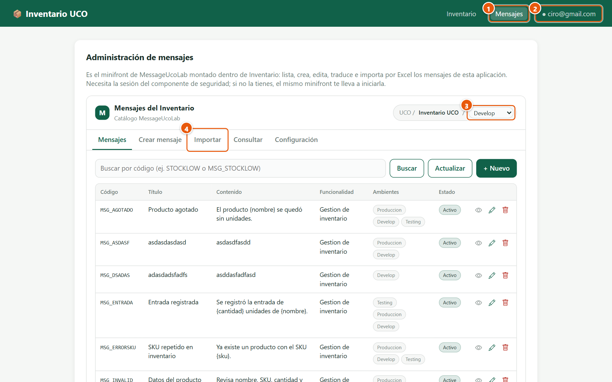

::: leyenda
1. **Mensajes** — la página nueva de tu aplicación.
2. **Sesión** — la del componente de seguridad; sin ella, el minifront pide iniciarla.
3. **Ambiente** — cambia entre Develop, Testing y Produccion; la aplicación queda fija por `lock-context`.
4. **Importar** — la misma importación por Excel del paso 6.5.
:::

> El minifront toma los colores y la letra de tu aplicación: no tienes que pasarle estilos.

### 9.6 Si tu pantalla usa otro front

El minifront no depende de Vue. Instalarlo (9.1) y reenviar `/messageucolab` (9.2) es igual en cualquier front;
solo cambia cómo montas la administración:

| Paso | En Vue | En otro front (React, Angular, HTML…) |
|---|---|---|
| Textos (9.3 y 9.4) | `obtenerMensaje(código)` y `useMensaje(código, variables)` | Una función `fetch('/api/mensajes/' + código)`; es la misma ruta de tu backend |
| Administrar mensajes (9.5) | `<MessageUcoLabAdmin>` | `mount(elemento, opciones)` y `unmount()` al salir de la página |

```javascript file=mensajes.js
import { mount } from 'minifront-mensajes'

// Administración: dentro de un elemento de tu página
const widget = mount(document.querySelector('#mensajes'), {
  apiBaseUrl: '/messageucolab',
  applicationName: 'Inventario UCO',
  environmentName: 'Develop',
  loginUrl: 'http://localhost:5173/login',
  lockContext: true
})
// al salir de la página: widget.unmount()
```

Si tu front usa Vite, el proxy del paso 9.2 es el mismo; con otro servidor de desarrollo, configura el mismo
reenvío (`/messageucolab` hacia `http://localhost:8000`, **sin** el encabezado `Origin`).

---

## 10. Probar que todo funciona

Esta es la prueba completa, de principio a fin. Si llegaste aquí siguiendo los pasos, funciona a la primera.

1. Revisa que estén encendidos: el componente de seguridad, MessageUcoLab (paso 4) y tu backend (paso 8.4).
2. En la carpeta de tu pantalla, arráncala:
   ```bash cwd=C:\…\tu-pantalla
   npm run dev
   ```
3. Abre tu aplicación. En Inventario UCO es <http://localhost:5177>. No hace falta iniciar sesión en
   MessageUcoLab.
4. Haz una acción que muestre un mensaje. En Inventario UCO: llena el formulario con un producto y pulsa
   **Guardar** (1). Aparece el aviso (2) **Producto guardado** con el texto de `MSG_PRODSAVED` y el nombre del producto ya
   puesto en lugar de `{nombre}`.

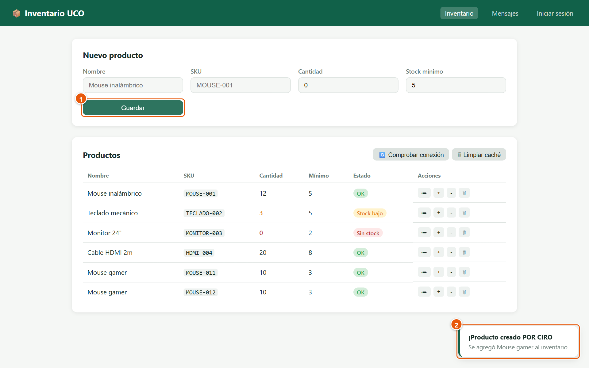

::: leyenda
1. **Guardar** — la acción de la aplicación.
2. **Aviso** — el texto viene de MessageUcoLab, con `{nombre}` ya reemplazado; la marca **✓ MessageUcoLab** confirma el origen.
:::

**Y ahora lo importante: cambiar un texto sin tocar el código.**

5. Abre <http://localhost:5174>, entra a tu aplicación y edita el título de `MSG_PRODSAVED`.
6. Vuelve a tu aplicación y guarda otro producto. El aviso muestra el texto nuevo. **No reiniciaste ni
   desplegaste nada.**

---

## 11. Preguntas frecuentes

**¿Tengo que repetir el paso 7 para cada ambiente?**
Sí. Una identidad lee un solo ambiente. Para Testing crea otra, por ejemplo `inventario-test`, repite 7.1 a
7.4 eligiendo **Testing** y arranca otro backend con su Client ID y su secreto.

**¿Cada persona que administra la misma aplicación crea sus identidades?**
Las identidades y las aplicaciones quedan a nombre de la persona con la que iniciaste sesión al crearlas.
Cada usuario ve y administra solo lo suyo.

**¿Por qué tengo que usar Doppler?**
Porque en el semillero ninguna contraseña puede quedar escrita en un archivo. Doppler guarda los secretos
fuera del código y los inyecta al arrancar.

**¿Los usuarios finales de mi aplicación pueden ver los mensajes?**
Sí. Tu backend los lee con su identidad, sin depender de quién haya iniciado sesión. Administrarlos (crear,
editar, importar) sí exige tu sesión y tus permisos en seguridad.

**¿Pido el texto desde el backend o desde la pantalla?**
Si el texto es la respuesta de una operación del backend, desde el backend (paso 8): así lo reciben igual todas
las pantallas que usen tu API. Si solo existe en la pantalla, como una validación o un aviso de la plantilla,
la pantalla se lo pide a tu backend (pasos 9.3 y 9.4).

**¿Cada cuánto se actualiza un mensaje en mi aplicación?**
Al guardar un producto, Inventario consulta el texto vigente en el momento. Los demás textos los guarda 5
minutos; pasado ese tiempo, o al pulsar **Limpiar caché**, vuelve a pedirlos a MessageUcoLab.

**¿Puedo traducir los mensajes?**
Sí, pero es opcional y viene apagado para que la instalación sea liviana. Para activarlo, levanta MessageUcoLab
con el perfil `ollama`, que es el que descarga Ollama y su modelo:
`doppler run -- docker compose -p messageucolab --profile ollama up -d`. Sin ese perfil, Ollama no se descarga.
Todo corre dentro de Docker, sin instalar nada en tu PC.

**Encenderla o apagarla desde el Catálogo de Parámetros (opcional).** Si tu equipo usa el componente de
Parámetros, puede decidir allí si se traduce, **sin reiniciar MessageUcoLab**. El valor de
`TRANSLATION_AI_ENABLED` queda solo como respaldo para cuando el Catálogo no tiene el parámetro o no responde.

1. En el frontend del Catálogo, en la aplicación de MessageUcoLab, crea el parámetro
   **`TRADUCCION_HABILITADA`** con el valor `true` (traducir) o `false` (no traducir).
2. En **Tokens → Nuevo**, crea un token para esa aplicación y ese ambiente. Copia su **ID** y su **secreto**: el
   secreto se muestra una sola vez.
3. Pon los valores en tu kit. El secreto va en **Doppler**, nunca en el `.env`:

| Variable | Dónde | Valor |
|---|---|---|
| `CATALOGO_PARAMETROS_BASE_URL` | `.env` de `messageucolab-local` | `http://host.docker.internal:8081/catalogo-parametros/api/v1` |
| `CATALOGO_PARAMETROS_TOKEN_ID` | `.env` de `messageucolab-local` | El ID del token |
| `CATALOGO_PARAMETROS_SECRETO` | Doppler | El secreto del token |

MessageUcoLab revisa el parámetro cada minuto: al cambiarlo en el Catálogo, en menos de un minuto empieza o deja
de traducir. Para que traduzca de verdad, tienes que haber levantado MessageUcoLab con `--profile ollama`.


**Cada pocos minutos MessageUcoLab dice "Tu sesión se perdió". ¿Es normal?**
Sí, por ahora. El acceso que entrega Keycloak dura 5 minutos y el componente de seguridad todavía no lo renueva
solo. Pulsa **Volver a Conectar**: es un solo clic y no vuelve a pedir la contraseña.

**Perdí la credencial técnica (`PEP_REGISTRATION_TOKEN`).**
En la pantalla de seguridad, **Aplicaciones** → **Rotar credencial** en MessageUcoLab. Copia la nueva,
actualízala en Doppler y, en la carpeta `messageucolab-local`, reinicia MessageUcoLab con
`doppler run -- docker compose -p messageucolab up -d`.

---

## Anexo A. Variables

**Secretos en tu Doppler de MessageUcoLab** (paso 3.1):

| Secreto | Para qué |
|---|---|
| `SURREALDBUSER` | Usuario de la base de datos |
| `SURREALDBPASSWORD` | Contraseña de la base de datos |
| `REDISPASSWORD` | Contraseña de la caché |
| `GF_SECURITY_ADMIN_PASSWORD` | Contraseña del panel de métricas (Grafana) |
| `PEP_REGISTRATION_TOKEN` | Credencial técnica de MessageUcoLab en tu componente de seguridad |
| `CATALOGO_PARAMETROS_SECRETO` | Opcional: secreto del token del Catálogo de Parámetros (traducción desde el Catálogo) |

**Configuración en el `.env` de `messageucolab-local`** (paso 4.1, no son secretos; ya viene lista):

| Variable | Valor |
|---|---|
| `MESSAGEUCOLAB_DOCKER_ORG` | `jciro17` |
| `MESSAGEUCOLAB_VERSION` | `0.3.0` |
| `MESSAGEUCOLAB_PORT` | `8085` |
| `APIGATEWAY_PORT` | `8000` |
| `KONGADMIN_PORT` | `8001` |
| `SURREALDBHOST` | `surrealdb` |
| `SURREALDBPORT` | `8005` |
| `SURREALDBNAMESPACE` | `messageucolab` |
| `SURREALDBDATABASE` | `messageucolab` |
| `REDISHOST` | `redis` |
| `REDISPORT` | `6379` |
| `REDISDATABASE` | `0` |
| `SECURITY_PDP_URL` | `http://host.docker.internal:18080` |
| `SECURITY_PEP_ENFORCEMENT_PEP_URL` | `http://host.docker.internal:18081` |
| `PULSAR_PORT` | `6800` |
| `PULSAR_GENERALPORT` | `8080` |
| `PULSAR_PORTEXIT` | `6650` |
| `PULSARTOPICNAME` | `crossword-topic` |
| `COMPOSE_PROFILES` | Comentada (`# COMPOSE_PROFILES=ollama`): el perfil se pone en el comando con `--profile ollama` |
| `TRANSLATION_AI_ENABLED` | `false` (respaldo si el Catálogo de Parámetros no tiene el parámetro) |
| `TRANSLATION_AI_PARAMETER_NAME` | `TRADUCCION_HABILITADA` |
| `CATALOGO_PARAMETROS_BASE_URL` | Vacía (opcional): dirección del Catálogo de Parámetros |
| `CATALOGO_PARAMETROS_TOKEN_ID` | Vacía (opcional): ID del token del Catálogo |
| `TRANSLATION_AI_PROVIDER` | `ollama` |
| `TRANSLATION_AI_BASE_URL` | `http://ollama:11434` |
| `TRANSLATION_AI_MODEL_NAME` | `llama3.2` |
| `LOKIPORT` | `3100` |
| `LOKIPORTALERT` | `9093` |
| `GRAFANAPORT` | `3000` |
| `PROMETHEUSPORT` | `9090` |
| `GRPC_OTELPORT` | `4317` |
| `HTTP_OTELPORT` | `4318` |
| `AZURE_KEYVAULT_ENABLED` | `false` |
| `AZURE_KEYVAULT_UCOLAB_ENDPOINT` | `https://no-usado.vault.azure.net/` |

**Configuración de tu backend** (paso 8.2):

| Variable | Valor |
|---|---|
| `MESSAGEUCOLAB_URL` | `http://localhost:8000` |
| `MESSAGEUCOLAB_CLIENT_ID` | El Client ID del paso 7.1 |
| `MESSAGEUCOLAB_CLIENT_SECRET` | El secreto del paso 7.1 (**secreto**: nunca en Git) |
| `KEYCLOAK_TOKEN_URI` | `http://keycloak.localhost:19090/realms/security-baseline/protocol/openid-connect/token` |

## Anexo B. Las 33 rutas de MessageUcoLab

Son las mismas del archivo `recursos-messageucolab-0.3.0.xlsx`. Las rutas 21 y 22 son las que usa la
identidad de servicio de tu backend: las concede el rol técnico `MESSAGE_CONSUMER` del paso 7.2. Las demás las
usan las personas que administran los mensajes (pasos 2.3 a 2.5).

| # | Método | Ruta |
|---|---|---|
| 1 | GET | `/messageucolab/v1/session/user` |
| 2 | GET | `/messageucolab/v1/session/applications` |
| 3 | GET | `/messageucolab/v1/organizations` |
| 4 | POST | `/messageucolab/v1/organizations` |
| 5 | GET | `/messageucolab/v1/organizations/{organizationId}/applications` |
| 6 | POST | `/messageucolab/v1/application` |
| 7 | POST | `/messageucolab/v1/application/functionality` |
| 8 | GET | `/messageucolab/v1/catalog/applications` |
| 9 | GET | `/messageucolab/v1/catalog/applications/{applicationId}/environments` |
| 10 | GET | `/messageucolab/v1/catalog/applications/{applicationId}/functionalities` |
| 11 | GET | `/messageucolab/v1/catalog/message-types` |
| 12 | GET | `/messageucolab/v1/catalog/message-categories` |
| 13 | GET | `/messageucolab/v1/catalog/message-states` |
| 14 | GET | `/messageucolab/v1/catalog/message-environment-states` |
| 15 | GET | `/messageucolab/v1/messages` |
| 16 | POST | `/messageucolab/v1/messages` |
| 17 | PUT | `/messageucolab/v1/messages/{messageCode}` |
| 18 | DELETE | `/messageucolab/v1/messages/{messageCode}` |
| 19 | POST | `/messageucolab/v1/messages/{messageCode}/translations` |
| 20 | GET | `/messageucolab/v1/messages/events` |
| 21 | GET | `/messageucolab/v1/messages/consumer` |
| 22 | POST | `/messageucolab/v1/messages/consumer/translations` |
| 23 | GET | `/messageucolab/v1/messages/imports/template` |
| 24 | POST | `/messageucolab/v1/messages/imports/validate` |
| 25 | GET | `/messageucolab/v1/messages/imports/{importId}` |
| 26 | GET | `/messageucolab/v1/messages/imports/{importId}/errors` |
| 27 | GET | `/messageucolab/v1/messages/imports/{importId}/result` |
| 28 | POST | `/messageucolab/v1/messages/imports/{importId}/confirm` |
| 29 | PATCH | `/messageucolab/v1/application/functionality/{functionalityId}/state` |
| 30 | DELETE | `/messageucolab/v1/application/{applicationId}` |
| 31 | GET | `/messageucolab/v1/application/{applicationId}/service-identities` |
| 32 | POST | `/messageucolab/v1/application/{applicationId}/service-identities` |
| 33 | DELETE | `/messageucolab/v1/application/{applicationId}/service-identities/{clientId}` |
